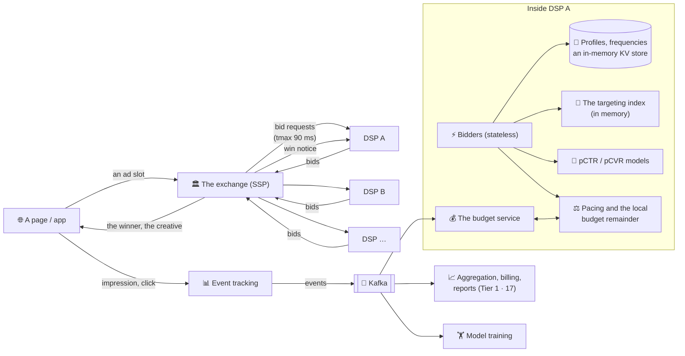
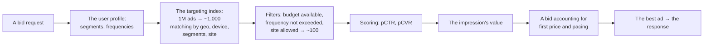
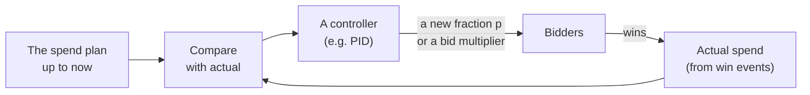
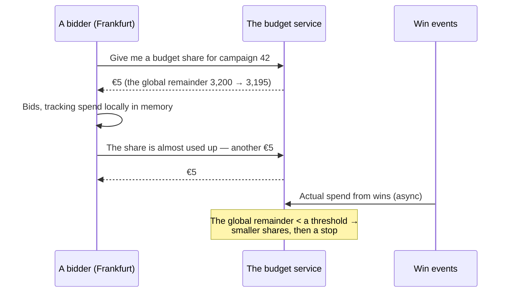

**English** | [Русский](README_RU.md)

# Tier 2 · 4D · 07. An Ad Auction / Real-Time Bidding

> **Level:** Advanced · **Interview time:** 45–60 min · **Study time:** ~5–6 h
> **Key aspects:** the RTB ecosystem (publisher, exchange, DSP), the OpenRTB protocol, a ~100 ms latency budget, fanning out bid requests with timeouts, auction mechanics (first and second price, floor prices), DSP internals (targeting, CTR prediction, computing the bid, bid shading), budget pacing, enforcing budgets in a distributed system, frequency capping, events and billing, scaling to millions of requests per second
> **Builds on:** [Tier 1 · 17 Ad Click Aggregator](../../../tier-1/17-ad-click-aggregator/README.md), [Tier 2 · 4D · 05 Fraud](../05-fraud-detection/README.md#7-deep-dive-1-the-latency-budget-and-behavior-on-failure), [Tier 2 · 4B · 01 TikTok Feed](../../4b-social-media/01-tiktok-feed/README.md#9-deep-dive-3-multi-stage-ranking), [Tier 2 · 4C · 07 Conflict-free Replication](../../4c-storage-databases/07-conflict-free-replication/README.md#12-deep-dive-7-the-limits--invariants-and-coordination) (escrow), [13-reliability-patterns](../../../13-reliability-patterns/README.md)

---

## 🗺️ How to Read This Walkthrough

The walkthrough follows an interview, but every step includes explanations: **why** a decision is made, **how** a mechanism works and **what happens** if you do it differently. The "📘 Explanation" blocks are theory right where you need it.

| Icon | Meaning |
|:----:|:--------|
| 🎤 | Interviewer |
| 🗣️ | What I (the candidate) say out loud |
| ✏️ | What I draw on the whiteboard |
| ⏱️ | Time budget for the step |
| 📘 | A detailed explanation of a concept |

Callouts: **TIP** — a good technique, **WARNING** — a trap, **IMPORTANT** — a Senior+ signal.

---

## 📑 Contents

0. [What This Problem Teaches](#0-what-this-problem-teaches)
1. [Problem Statement](#1-problem-statement)
2. [Clarifying Questions and Requirements](#2-clarifying-questions-and-requirements)
3. [Capacity Estimates](#3-capacity-estimates)
4. [The Protocol and the Participants](#4-the-protocol-and-the-participants)
5. [High-Level Design](#5-high-level-design)
6. [Deep Dive 1: The Latency Budget](#6-deep-dive-1-the-latency-budget)
7. [Deep Dive 2: The Exchange — Fan-Out and the Auction](#7-deep-dive-2-the-exchange--fan-out-and-the-auction)
8. [Deep Dive 3: The DSP — From Request to Bid](#8-deep-dive-3-the-dsp--from-request-to-bid)
9. [Deep Dive 4: Budget Pacing](#9-deep-dive-4-budget-pacing)
10. [Deep Dive 5: Enforcing Budgets in a Distributed System](#10-deep-dive-5-enforcing-budgets-in-a-distributed-system)
11. [Deep Dive 6: Frequency Capping and User Data](#11-deep-dive-6-frequency-capping-and-user-data)
12. [Deep Dive 7: Events, Billing and Feedback](#12-deep-dive-7-events-billing-and-feedback)
13. [Deep Dive 8: Scale and Operations](#13-deep-dive-8-scale-and-operations)
14. [Bottlenecks and Failure Scenarios](#14-bottlenecks-and-failure-scenarios)
15. [What Changes at 10x Scale](#15-what-changes-at-10x-scale)
16. [Key Concepts and New Terms](#16-key-concepts-and-new-terms)
17. [Variations and Follow-Up Questions](#17-variations-and-follow-up-questions)
18. [Common Mistakes](#18-common-mistakes)
19. [Cheat Sheet and Self-Check](#19-cheat-sheet-and-self-check)

---

## 0. What This Problem Teaches

Every time a page with ads opens, an auction runs within ~100 ms: the publisher announces an available slot, an exchange sends the request to dozens of buyers, each decides within tens of milliseconds how much it's willing to pay for this particular user in this particular slot — and the best bid wins. Millions of such auctions run every second, and meanwhile an advertiser's daily budget mustn't be spent in the first hour.

| What's tested | Where it shows up |
|:--------------|:------------------|
| Strict latency constraints | The whole auction within ~100 ms |
| Fan-out and tail latency | Requests to dozens of participants with timeouts |
| Auction mechanics | First and second price, floor prices, bid shading |
| ML on the critical path | Predicting the probability of a click and a conversion |
| Feedback control | Spreading a budget across the day |
| Distributed counters | A budget across hundreds of instances without overspending |
| Event streams | Impressions, clicks, billing |

> [!TIP]
> Clarify right away **which side we're designing**: the exchange (ad exchange / SSP) or the buyer (DSP). It's usually best to describe the whole chain briefly and go deep on the DSP: that's where the interesting parts are — computing the bid and pacing the budget.

---

## 1. Problem Statement

> 🎤 "Design a real-time bidding system: when a user opens a page, the ad slot is sold at auction among advertisers within 100 ms. Design the exchange and a buyer platform (DSP) that bids on advertisers' behalf while respecting their budgets."

**What it looks like:**

```
Anna opens a news site → a 300×250 banner slot
Within ~100 ms the exchange: bid requests to 20 buyers → 12 answered in time → the best bid is a €2.40 CPM
A sporting goods store's banner is shown; the store's DSP debited €0.0024 from the campaign budget
A campaign with a €10,000/day budget spends it evenly until evening, not in the first hour
Anna sees this banner no more than 3 times a day
```

**Time plan:**

| Step | ⏱️ |
|:-----|:--:|
| Requirements | 5 min |
| Estimates | 4 min |
| The protocol and participants | 4 min |
| High-level design | 5 min |
| Deep dives | 25 min |
| Wrap-up | 3 min |

---

## 2. Clarifying Questions and Requirements

⏱️ 5 min

| My question | Interviewer's answer | What it changes and why |
|:------------|:---------------------|:------------------------|
| Which side are we designing? | Both, with more depth on the DSP | The whole chain, the buyer's details |
| The exchange's load? | ~5M ad requests per second at peak | A huge fan-out |
| The DSP's load? | ~2M bid requests per second | Scoring millions per second |
| Latency? | The exchange gives a buyer ~80–100 ms (tmax), including the network | Everything in memory, close to the exchange |
| The auction type? | First price with a floor | Bid shading |
| Campaigns? | ~1M active ads | A targeting index |
| Budgets? | Daily, spent evenly; overspend no more than ~1% | Pacing and distributed accounting |
| Frequency caps? | Yes, per user and campaign | A fast counter store |
| Privacy? | Only consented user data | Contextual targeting as a fallback |

### Functional requirements

1. The exchange: accept an ad request, send bid requests, run the auction, return the winner.
2. The DSP: find suitable ads, estimate an impression's value, bid or decline.
3. Pacing campaign budgets across the day; enforcing limits.
4. Frequency caps.
5. Tracking impressions, clicks, conversions; billing; reports.

### Non-functional requirements

| Requirement | Target | Why |
|:------------|:-------|:----|
| DSP response latency | p99 < ~50–80 ms (server-side) | A late bid doesn't participate |
| Throughput | Millions of requests per second | The size of the ad market |
| Budget overspend | ≤ ~1% | An advertiser pays only what was agreed |
| Availability | High; under overload — a fast no-bid | A no-bid is safe; a slow response is useless |
| Billing accuracy | No double counting | Money |

---

## 3. Capacity Estimates

⏱️ 4 min

```
The exchange:   5M ad requests/s × a fan-out to ~20 DSPs = 100M bid requests/s
                × ~2 KB per request ≈ 200 GB/s of outbound traffic ❗
                → you must choose which DSPs to send to (traffic shaping)

A DSP:          2M requests/s; for each — selecting ~100 candidates and scoring them
                → ~200M model evaluations per second
Wins:           ~5% of bids → ~100,000 impressions/s → budget and frequency updates
Profiles:       hundreds of millions of users × ~1 KB ≈ hundreds of GB in an in-memory KV store
```

### Conclusions

| Conclusion | Design consequence |
|:-----------|:-------------------|
| The exchange's fan-out is hundreds of GB/s | Selecting DSPs by bid probability, QPS limits |
| Hundreds of millions of model evaluations | Lightweight models, optimized inference, filtering candidates before scoring |
| Budgets change 100,000 times per second | Distributed accounting with local shares |
| Everything must fit within tens of ms | Data in memory, servers close to exchanges |

---

## 4. The Protocol and the Participants

⏱️ 4 min

| Participant | Role |
|:------------|:-----|
| **A publisher** | A site or app with an ad slot |
| **An SSP / exchange** | Sells the publisher's impressions and runs the auction |
| **A DSP** | Buys impressions on advertisers' behalf and places bids |
| **An advertiser** | Campaigns, budgets, creatives, goals |

### OpenRTB (simplified)

```json
A bid request (exchange → DSP):
{
  "id": "req_81", "tmax": 90,
  "imp": [{ "id": "1", "banner": { "w": 300, "h": 250 }, "bidfloor": 0.8, "bidfloorcur": "EUR" }],
  "site": { "domain": "news.example", "cat": ["IAB12"] },
  "device": { "ua": "…", "geo": { "country": "POL", "city": "Warsaw" }, "devicetype": 2 },
  "user": { "id": "exchange-user-7f", "consent": "…" }
}

A response (DSP → exchange):
{ "id": "req_81", "seatbid": [{ "bid": [{ "impid": "1", "price": 2.40,
   "adm": "<creative>", "crid": "cr_55", "nurl": "https://dsp…/win?price=${AUCTION_PRICE}" }] }] }

A no-bid: HTTP 204 — cheap and safe
```

📘 `bidfloor` is the publisher's minimum price; `tmax` is how many milliseconds the DSP has; `nurl` is the win notice carrying the final price.

---

## 5. High-Level Design

⏱️ 5 min



🗣️ "The chain: publisher → exchange → parallel requests to DSPs with a timeout → the auction → the creative on the page → impression and click events.

Inside the DSP: **stateless bidders** close to the exchanges keep the targeting index and models in memory; they read the user's profile and frequencies from an in-memory KV store; **pacing** decides whether to participate and how much to bid, using **a local budget share** from the central budget service. Impression and click events go to Kafka: debiting budgets, billing, reports, model training."

---

## 6. Deep Dive 1: The Latency Budget

> 🎤 "The DSP has 90 ms, including the network. How do you split them?"

```
The network exchange → DSP (the same cloud region or a nearby data center)   ~5–10 ms
Parsing the request                                                           ~1 ms
The user profile and frequencies (an in-memory KV store)                      ~2–5 ms
Selecting candidates from the targeting index                                 ~2–5 ms
Filters: budget, frequency, brand safety                                      ~1 ms
Scoring ~100 candidates (pCTR, pCVR)                                          ~5–15 ms
Computing the bid, bid shading, the response                                  ~1–2 ms
The network DSP → exchange                                                    ~5–10 ms
Total                                                                         ~25–50 ms, with headroom before tmax
```

| Technique | Why |
|:----------|:----|
| **Placing bidders close to exchanges** | A cross-region network would eat the whole budget |
| **Everything in memory** (the index, models, profiles) | Not a single disk access on the critical path |
| **An internal deadline** shorter than tmax | If we haven't finished by 60 ms — answer with a no-bid |
| **No-bids under overload** | A fast 204 beats a slow response: a late bid is useless and the queue grows |
| Everything that doesn't affect the bid — asynchronously | Logs, counter updates |

> [!IMPORTANT]
> **Senior+ signal:** in RTB **a late bid is the same as no bid**, only more expensive. So overload protection means no-bidding (load shedding), not queues and retries.

---

## 7. Deep Dive 2: The Exchange — Fan-Out and the Auction

> 🎤 "The exchange sends the request to 20 buyers. How do you run the auction within 100 ms?"

### Fan-out

| Decision | Why |
|:---------|:----|
| Parallel sending with a shared deadline | Wait until tmax; late responders don't participate |
| **Selecting DSPs** (traffic shaping) | Send a request only to those likely to bid (by history: this DSP almost never buys mobile impressions in this country) — saving hundreds of GB/s |
| **Per-DSP QPS limits** | A buyer sets how many requests it can handle |
| Connection pools, HTTP/2, compression | The overhead of millions of requests |

### Auction mechanics

| Type | Who pays how much | Comment |
|:-----|:------------------|:--------|
| **Second price** | The winner pays the second bid + an increment | Encourages bidding true value; historically the RTB standard |
| **First price** ⭐ | The winner pays their own bid | The industry moved to first price around 2019 (partly because of header bidding); buyers use bid shading |
| **A floor price** | Bids below it don't participate | Protects the publisher's revenue |

```
Bids: A = €2.40, B = €2.10, C = €0.70 (below the €0.80 floor) — CPM
First price:   A wins and pays €2.40 per thousand impressions → €0.0024 for this impression
Second price:  A wins and pays €2.10 + an increment
```

### In addition

- Quality filters: brand safety, prohibited categories, creative verification.
- Detecting invalid traffic (bots, spoofed publishers) **before** the auction.
- Notifying the winner (`nurl` / `burl`) with the final price.

---

## 8. Deep Dive 3: The DSP — From Request to Bid

> 🎤 "A request arrived. How does the DSP decide whether to bid, and how much?"

### The funnel



### The targeting index

📘 Each ad is a boolean condition ("country = PL AND device = mobile AND (segment = sports OR the site's category is sports)"). Checking 1M conditions on every request is impossible. **An inverted index** over attribute values (as in search) quickly finds the ads whose conditions might be satisfied, and then the exact conditions are checked.

### An impression's value

```
The campaign's goal: a cost per acquisition (CPA) of €20
The model: pCTR = 0.5%, pCVR (a purchase after a click) = 2%

The value of one impression = pCTR × pCVR × CPA = 0.005 × 0.02 × €20 = €0.002
Per thousand impressions (CPM) = €2.00
```

### Bid shading in a first-price auction

📘 In a first-price auction, bidding the full value is unprofitable: if competitors bid €1.30, a €2.00 bid overpays by €0.70. **Bid shading** is a model that estimates the probability of winning at different bids (from this publisher's auction history), choosing the bid that maximizes the expected gain: `P(win | bid) × (value − bid)`.

```
Value €2.00:
  bid 2.00 → P(win) 0.60 → expected gain 0.60 × 0.00 = 0
  bid 1.40 → P(win) 0.45 → 0.45 × 0.60 = 0.27
  bid 1.00 → P(win) 0.15 → 0.15 × 1.00 = 0.15
→ bid ~€1.40
```

> [!TIP]
> pCTR/pCVR models use the same multi-stage approach as in [the feed](../../4b-social-media/01-tiktok-feed/README.md#9-deep-dive-3-multi-stage-ranking): a cheap filter, then an accurate model on a few candidates. Calibrating the probabilities matters — the bid is directly proportional to them.

---

## 9. Deep Dive 4: Budget Pacing

> 🎤 "A campaign has €10,000 for the day. If it bids on everything that matches, the money runs out by 9 a.m. How do you spread it?"

### Why

📘 An advertiser wants a presence all day (evening shoppers are no worse than morning ones), and the best impressions are spread over time. Spending the whole budget in the morning loses reach and usually means worse prices.

### A spend plan

```
Traffic varies by hour → the spend plan follows expected traffic:
  09:00–10:00: 5% of the budget = €500
  19:00–20:00: 9% of the budget = €900
By 14:00 the plan says €4,800 should have been spent
```

### Two ways to control it

| Method | How | Pros | Cons |
|:-------|:----|:-----|:-----|
| **Skipping auctions** (throttling) | Participate in only a fraction p of auctions; if spending faster than planned — lower p | Simple; doesn't change bids | Randomly skips good impressions too |
| **Modifying bids** | A bid multiplier: spending fast — lower the bids | Wins the cheap impressions rather than random ones | Harder to control |

### Feedback control



📘 Every few seconds the controller compares actual spend with the plan and adjusts the participation fraction or the bid multiplier. The proportional term reacts to the current deviation, the integral term to the accumulated one, and the derivative term smooths sharp changes.

---

## 10. Deep Dive 5: Enforcing Budgets in a Distributed System

> 🎤 "Hundreds of bidders around the world bid for one campaign, and they learn of wins seconds later. How do you avoid spending more than the budget?"

### The problem

📘 Each bidder decides within milliseconds and can't ask a central service on every request. Meanwhile spend becomes known only after the win notice (seconds). If €10 of budget remains and hundreds of bidders simultaneously win €0.002 thousands of times — an overspend.

### The solution: local budget shares



| Decision | Why |
|:---------|:----|
| **Budget shares (escrow)** handed to bidders | The bid decision is local, with no network call (the same technique as in [4C · 07](../../4c-storage-databases/07-conflict-free-replication/README.md#12-deep-dive-7-the-limits--invariants-and-coordination)) |
| A bidder counts **potential** spend from its bids, not just confirmed spend | Wins are confirmed with a delay |
| **Shrinking shares** toward the end of the budget | The less that remains, the less each bidder gets — a more precise stop |
| Stopping at a threshold | Once the global remainder is less than the sum of issued shares, no new ones are issued |
| Overspend tolerance | A small one (≤ 1%) is inevitable because of notification delays; it's agreed with the advertiser, and anything beyond the limit isn't billed |
| Unused shares | Returned when a bidder fails, after its lease expires |

---

## 11. Deep Dive 6: Frequency Capping and User Data

> 🎤 "How do you show a banner to one user no more than 3 times a day?"

| Decision | Why |
|:---------|:----|
| A counter `(user_id, campaign_id) → impressions today` in an in-memory KV store (Aerospike, Redis) with a TTL | Read within milliseconds on every request |
| Incremented **on the actual impression**, not on the bid | There are far more bids than wins |
| Updated asynchronously (an impression event) | A race is possible: two simultaneous auctions yield a 4th impression; a small excess is acceptable |
| A strict cap when needed | Track "pending" wins locally |

### User data and privacy

| Aspect | Solution |
|:-------|:---------|
| A user identifier | Only with consent (a consent string in the request); matching the exchange's and the DSP's IDs via cookie sync, which is increasingly unavailable |
| Interest segments | Built from advertisers' first-party data and consented sources |
| No identifier | **Contextual targeting**: the page's category, keywords, geo, time |
| Laws | GDPR, ePrivacy: store the minimum, honor opt-outs |

📘 The industry is moving toward less availability of third-party cookies and device identifiers; RTB systems rely more and more on context and the first-party data of publishers and advertisers.

---

## 12. Deep Dive 7: Events, Billing and Feedback

> 🎤 "A bid won. What happens next with the money and the data?"

```
The win notice (nurl / burl)          → the winning price
An impression (a pixel or SDK event)  → debiting the budget, frequencies
A click                               → statistics, pCTR training
A conversion (hours to days later)    → attribution, pCVR training
```

| Decision | Why |
|:---------|:----|
| Every event → Kafka → an aggregator | The same pipeline as in [the click aggregator](../../../tier-1/17-ad-click-aggregator/README.md): dedup, anti-fraud, event windows, reconciliation |
| **Debiting the budget per impression** (or per the exchange's confirmation) | The advertiser pays for a real impression |
| Dedup by impression ID | Repeated pixels don't debit twice |
| Reconciling with the exchange | The exchange's win report versus the DSP's own accounting |
| Attribution windows | A conversion is credited to an impression or click within a window (e.g. 7 days) |
| Training | A log of "request features + bid + outcome" → pCTR, pCVR and win-probability models |

---

## 13. Deep Dive 8: Scale and Operations

| Topic | Solution |
|:------|:---------|
| Scaling bidders | Stateless, horizontal, in regions close to exchanges |
| Campaign updates | Changes (new ads, pauses, budgets) reach the in-memory indexes within seconds via an event stream |
| Model updates | A new version loads into memory next to the old one and switches atomically; A/B tests of bidding strategies on a share of traffic |
| Overload | No-bids (204) when the internal deadline or a queue is exceeded |
| Cost | Inbound traffic is enormous — declining unneeded requests (agreements with exchanges on filtering) |
| Monitoring | p99 latency, the timeout rate, the win rate, spend versus plan, overspend per campaign |

---

## 14. Bottlenecks and Failure Scenarios

| Scenario | What happens | How we protect |
|:---------|:-------------|:---------------|
| The DSP misses tmax | The bid doesn't participate | An internal deadline, no-bids, everything in memory |
| Bidders are overloaded | Every response gets slower | Load shedding via no-bids |
| The exchange's fan-out is hundreds of GB/s | Network cost | Selecting DSPs, QPS limits |
| Bidding full value in a first-price auction | Overpaying | Bid shading |
| The budget is spent in the morning | No reach in the evening | Pacing with feedback |
| Overspending the budget | Money that can't be billed | Local shares, shrinking shares, a threshold |
| Exceeding a frequency cap | Annoying the user | In-memory counters, tracking pending wins |
| Repeated pixels | Double debits | Dedup by impression ID |
| An uncalibrated model | Systematically inflated bids | Calibration, monitoring |
| Invalid traffic | Paying for bots | Filtering at the exchange and in the DSP |

---

## 15. What Changes at 10x Scale

> 🎤 "20 million bid requests per second?"

| Change | Why |
|:-------|:----|
| **Specialized inference** (quantized models, accelerators) | Billions of evaluations per second |
| **More aggressive filtering** of requests before scoring | Compute cost |
| **Direct integrations with publishers** (fewer intermediaries) | Latency and fees |
| **Real-time learning** for pacing and win probability | Fast market changes |

---

## 16. Key Concepts and New Terms

### What's applied

| Concept | Where it's covered | How it applies here |
|:--------|:-------------------|:--------------------|
| Click aggregation and billing | [Tier 1 · 17](../../../tier-1/17-ad-click-aggregator/README.md) | Events after the auction |
| A latency budget on the critical path | [Tier 2 · 4D · 05](../05-fraud-detection/README.md) | Responding within tens of ms |
| Multi-stage ranking | [Tier 2 · 4B · 01](../../4b-social-media/01-tiktok-feed/README.md) | Selecting and scoring ads |
| Escrow | [Tier 2 · 4C · 07](../../4c-storage-databases/07-conflict-free-replication/README.md) | Budget shares for bidders |
| Load shedding | [13-reliability-patterns](../../../13-reliability-patterns/README.md) | No-bids under overload |

### New terms in this problem

| Term | In short |
|:-----|:---------|
| **An SSP, an exchange, a DSP** | The seller, the place the auction runs, the buyer |
| **OpenRTB** | The standard protocol for bid requests and responses |
| **tmax** | The buyer's time to respond |
| **A bid floor** | The publisher's minimum price |
| **First- and second-price auctions** | The winner pays their own or the second bid |
| **Bid shading** | Bidding below value in a first-price auction |
| **pCTR, pCVR, CPM, CPA** | Click and conversion probabilities, the price per thousand impressions and per acquisition |
| **A targeting index** | Fast selection of ads by condition |
| **Pacing** | Spreading a budget over time |
| **Budget shares (escrow)** | Bidders' local limits against overspend |
| **A frequency cap** | The maximum impressions per user |
| **Traffic shaping** | Selecting which DSPs to send requests to |

---

## 17. Variations and Follow-Up Questions

<details>
<summary><b>How does RTB differ from ads in your own feed (Facebook, TikTok)?</b></summary>

In its own feed a platform owns the slot, the user data and the ads: the auction runs inside one system (no network fan-out to external buyers), and ranking combines the advertiser's bid, predicted engagement and ad quality. Latency is less strict, and there's more data about the user.
</details>

<details>
<summary><b>How does search advertising (Google Ads) work?</b></summary>

Ads are tied to keywords; an auction runs on every search; the final position depends on the bid and a quality score (expected CTR, relevance). Historically a generalized second-price auction (GSP) was used: each advertiser pays the minimum needed to hold their position.
</details>

<details>
<summary><b>What is header bidding?</b></summary>

The publisher queries several exchanges in parallel (right in the browser or on a server) before calling its main ad server, so the competition is simultaneous rather than sequential. It's one of the reasons the industry moved to first-price auctions.
</details>

<details>
<summary><b>How do you split a budget among one advertiser's several campaigns?</b></summary>

The advertiser's overall budget → campaign budgets → pacing for each. If campaigns compete for the same impression, the DSP picks one ad (the best by value, accounting for pacing) rather than bidding against itself.
</details>

<details>
<summary><b>How does a DSP estimate win probability for bid shading?</b></summary>

From the history of its bids and outcomes (won or not, at what price, if the exchange reports the minimum winning price), it builds a model of the winning-price distribution for a "publisher × format × time" segment. The model is updated often — the market changes quickly.
</details>

---

## 18. Common Mistakes

| ❌ Mistake | Why it's bad | ✅ Do this instead |
|:----------|:-------------|:------------------|
| Hitting a DB on the critical path | Missing tmax | Everything in memory |
| Bidders in one region for the whole world | The network eats the latency budget | Close to the exchanges |
| Queues and retries under overload | Every response is late | Fast no-bids |
| Sending the request to every DSP | Hundreds of GB/s | Selection and QPS limits |
| Bidding full value in a first-price auction | Overpaying | Bid shading |
| Checking 1M targeting conditions per request | Slow | An inverted index |
| Bidding on everything that matches | The budget runs out in the morning | Pacing |
| A central budget counter per bid | A network call, a bottleneck | Local shares |
| Debiting the budget per bid | Wrong accounting | Per impression or confirmation |
| Uncalibrated pCTR | Systematic bidding errors | Calibration |

---

## 19. Cheat Sheet and Self-Check

### 30-second answer

> Publisher → exchange: an ad request; within a tmax of ~90–100 ms the exchange sends OpenRTB requests to selected DSPs (traffic shaping, QPS limits — otherwise hundreds of GB/s), gathers responses until the deadline, runs a first-price auction with a floor, returns the creative and sends a win notice. The DSP: stateless bidders close to the exchanges, everything in memory; the profile and frequencies from a KV store → an inverted targeting index (1M ads → ~1,000) → filters (budget, frequency, safety) → pCTR/pCVR scoring (~100 candidates) → value = pCTR × pCVR × CPA → bid shading using a win-probability model → the best ad; an internal deadline and no-bids (204) under overload. Pacing: a spend plan following the traffic profile, with a feedback controller adjusting the participation fraction or a bid multiplier. A budget across hundreds of bidders — local shares (escrow) from the budget service, shrinking toward the end, a stop threshold, an overspend tolerance ≤ 1%. Frequencies — (user, campaign) counters with a TTL, incremented on impressions. Impression, click and conversion events → Kafka → dedup, anti-fraud, billing, reconciliation with the exchange, model training.

### Self-check

- [ ] I can name the RTB participants and describe a request's path
- [ ] I can break down a DSP's latency budget
- [ ] I can explain why overload calls for no-bids
- [ ] I can describe the exchange's fan-out and traffic shaping
- [ ] I can compare first- and second-price auctions
- [ ] I can describe the DSP funnel from request to bid
- [ ] I can compute an impression's value and explain bid shading with an example
- [ ] I can design pacing with feedback
- [ ] I can prevent budget overspend across hundreds of bidders
- [ ] I can describe frequency caps and the event flow for billing

### Further reading

- IAB Tech Lab, *OpenRTB 2.x / 3.0 Specification*
- Agarwal et al., *Budget Pacing for Targeted Online Advertisements at LinkedIn* (KDD 2014)
- Google's articles on moving Ad Manager to a first-price auction (2019)
- He et al., *Practical Lessons from Predicting Clicks on Ads at Facebook* (2014)
- The [Tier 1 · 17 Ad Click Aggregator](../../../tier-1/17-ad-click-aggregator/README.md) walkthrough
