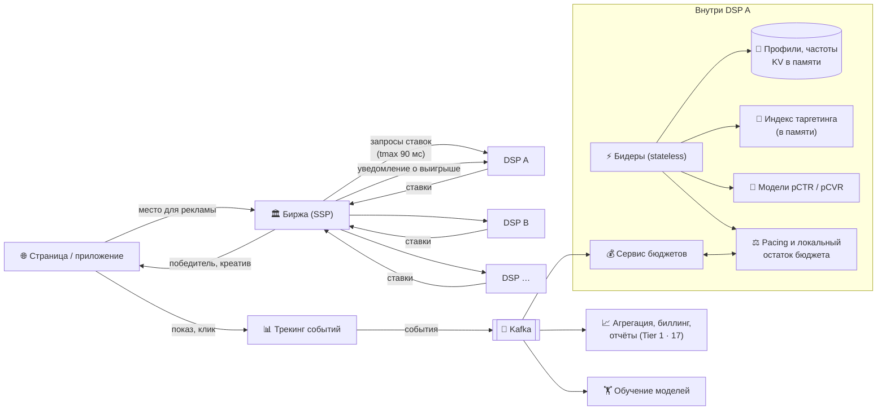
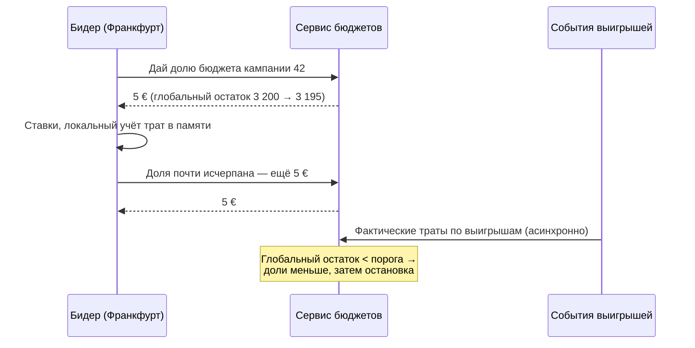

[English](README.md) | **Русский**

# Tier 2 · 4D · 07. Рекламный аукцион / Real-Time Bidding

> **Уровень:** Advanced · **Время на интервью:** 45–60 мин · **Время на разбор:** ~5–6 ч
> **Ключевые аспекты:** экосистема RTB (площадка, биржа, DSP), протокол OpenRTB, бюджет задержки ~100 мс, fan-out запросов ставок с таймаутами, механика аукциона (первая и вторая цена, минимальная цена), устройство DSP (таргетинг, предсказание CTR, расчёт ставки, bid shading), распределение бюджета (pacing), распределённое соблюдение бюджета, частотные ограничения, события и биллинг, масштаб миллионов запросов в секунду
> **Опирается на:** [Tier 1 · 17 Ad Click Aggregator](../../../tier-1/17-ad-click-aggregator/README_RU.md), [Tier 2 · 4D · 05 Fraud](../05-fraud-detection/README_RU.md#7-deep-dive-1-бюджет-задержки-и-поведение-при-сбоях), [Tier 2 · 4B · 01 TikTok Feed](../../4b-social-media/01-tiktok-feed/README_RU.md#9-deep-dive-3-многоэтапное-ранжирование), [Tier 2 · 4C · 07 Conflict-free Replication](../../4c-storage-databases/07-conflict-free-replication/README_RU.md#12-deep-dive-7-пределы--инварианты-и-координация) (escrow), [13-reliability-patterns](../../../13-reliability-patterns/README_RU.md)

---

## 🗺️ Как читать этот разбор

Разбор построен как интервью, но в каждом шаге есть объяснения: **почему** принимается решение, **как работает** механизм и **что будет**, если сделать иначе. Блоки «📘 Объяснение» — теория прямо по ходу задачи.

| Значок | Что значит |
|:------:|:-----------|
| 🎤 | Реплика интервьюера |
| 🗣️ | Что говорю вслух я (кандидат) |
| ✏️ | Что рисую на доске |
| ⏱️ | Сколько времени тратить на шаг |
| 📘 | Подробное объяснение концепции |

Блоки **TIP** — хороший приём, **WARNING** — ловушка, **IMPORTANT** — сигнал для уровня Senior+.

---

## 📑 Содержание

0. [Чему учит эта задача](#0-чему-учит-эта-задача)
1. [Условие задачи](#1-условие-задачи)
2. [Уточняющие вопросы и требования](#2-уточняющие-вопросы-и-требования)
3. [Оценки нагрузки](#3-оценки-нагрузки)
4. [Протокол и участники](#4-протокол-и-участники)
5. [High-level дизайн](#5-high-level-дизайн)
6. [Deep dive 1: бюджет задержки](#6-deep-dive-1-бюджет-задержки)
7. [Deep dive 2: биржа — fan-out и аукцион](#7-deep-dive-2-биржа--fan-out-и-аукцион)
8. [Deep dive 3: DSP — от запроса до ставки](#8-deep-dive-3-dsp--от-запроса-до-ставки)
9. [Deep dive 4: распределение бюджета (pacing)](#9-deep-dive-4-распределение-бюджета-pacing)
10. [Deep dive 5: соблюдение бюджета в распределённой системе](#10-deep-dive-5-соблюдение-бюджета-в-распределённой-системе)
11. [Deep dive 6: частотные ограничения и данные пользователя](#11-deep-dive-6-частотные-ограничения-и-данные-пользователя)
12. [Deep dive 7: события, биллинг и обратная связь](#12-deep-dive-7-события-биллинг-и-обратная-связь)
13. [Deep dive 8: масштаб и эксплуатация](#13-deep-dive-8-масштаб-и-эксплуатация)
14. [Узкие места и сценарии сбоев](#14-узкие-места-и-сценарии-сбоев)
15. [Что изменится при росте в 10 раз](#15-что-изменится-при-росте-в-10-раз)
16. [Ключевые концепции и новые понятия](#16-ключевые-концепции-и-новые-понятия)
17. [Варианты задачи и follow-up вопросы](#17-варианты-задачи-и-follow-up-вопросы)
18. [Типичные ошибки](#18-типичные-ошибки)
19. [Шпаргалка и самопроверка](#19-шпаргалка-и-самопроверка)

---

## 0. Чему учит эта задача

Каждый раз, когда открывается страница с рекламой, за ~100 мс проходит аукцион: площадка сообщает о свободном месте, биржа рассылает запрос десяткам покупателей, каждый за десятки миллисекунд решает, сколько готов заплатить именно за этого пользователя в этом месте, — и побеждает лучшая ставка. Миллионы таких аукционов в секунду, и при этом нужно не потратить дневной бюджет рекламодателя за первый час.

| Что проверяют | Где это в задаче |
|:--------------|:-----------------|
| Жёсткие ограничения задержки | Весь аукцион за ~100 мс |
| Fan-out и хвостовая задержка | Запрос к десяткам участников с таймаутами |
| Механизм аукциона | Первая и вторая цена, минимальная цена, bid shading |
| ML на критическом пути | Предсказание вероятности клика и конверсии |
| Управление с обратной связью | Распределение бюджета по дню |
| Распределённые счётчики | Бюджет на сотнях экземпляров без перерасхода |
| Потоки событий | Показы, клики, биллинг |

> [!TIP]
> Сразу уточни, **какую сторону проектируем**: биржу (ad exchange / SSP) или покупателя (DSP). Обычно лучше кратко описать всю цепочку, а глубоко уйти в DSP: там самое интересное — расчёт ставки и распределение бюджета.

---

## 1. Условие задачи

> 🎤 «Спроектируй систему real-time bidding: когда пользователь открывает страницу, рекламное место продаётся на аукционе среди рекламодателей за 100 мс. Нужно спроектировать биржу и платформу покупателя (DSP), которая делает ставки от имени рекламодателей с учётом их бюджетов».

**Как это выглядит:**

```
Анна открывает новостной сайт → место для баннера 300×250
Биржа за ~100 мс: запрос ставки 20 покупателям → 12 ответили вовремя → лучшая ставка 2,40 € CPM
Показан баннер спортивного магазина; DSP магазина списала 0,0024 € с бюджета кампании
Кампания с бюджетом 10 000 €/день тратит его равномерно до вечера, а не за первый час
Анна видит этот баннер не больше 3 раз в день
```

**План по времени:**

| Шаг | ⏱️ |
|:----|:--:|
| Требования | 5 мин |
| Оценки | 4 мин |
| Протокол и участники | 4 мин |
| High-level дизайн | 5 мин |
| Deep dives | 25 мин |
| Итоги | 3 мин |

---

## 2. Уточняющие вопросы и требования

⏱️ 5 мин

| Мой вопрос | Ответ интервьюера | Что это меняет и почему |
|:-----------|:------------------|:------------------------|
| Какую сторону проектируем? | Обе, глубже — DSP | Цепочка целиком, детали покупателя |
| Нагрузка биржи? | ~5M запросов на показ в секунду в пик | Огромный fan-out |
| Нагрузка DSP? | ~2M запросов ставок в секунду | Скоринг на миллионы в секунду |
| Задержка? | Биржа даёт покупателю ~80–100 мс (tmax), включая сеть | Всё в памяти, рядом с биржей |
| Тип аукциона? | Первой цены с минимальной ценой | Bid shading |
| Кампаний? | ~1M активных объявлений | Индекс таргетинга |
| Бюджеты? | Дневные, равномерная трата; перерасход — не больше ~1% | Pacing и распределённый учёт |
| Частотные ограничения? | Да, на пользователя и кампанию | Быстрое хранилище счётчиков |
| Приватность? | Только согласованные данные пользователя | Контекстный таргетинг как запасной вариант |

### Функциональные требования

1. Биржа: принять запрос на показ, разослать запросы ставок, провести аукцион, вернуть победителя.
2. DSP: найти подходящие объявления, оценить ценность показа, сделать ставку или отказаться.
3. Распределение бюджета кампаний по дню; соблюдение лимитов.
4. Частотные ограничения.
5. Учёт показов, кликов, конверсий; биллинг; отчёты.

### Нефункциональные требования

| Требование | Цель | Почему |
|:-----------|:-----|:-------|
| Задержка ответа DSP | p99 < ~50–80 мс (на сервере) | Опоздавшая ставка не участвует |
| Пропускная способность | Миллионы запросов в секунду | Объём рекламного рынка |
| Перерасход бюджета | ≤ ~1% | Рекламодатель платит только оговорённое |
| Доступность | Высокая; при перегрузке — быстрый отказ от ставки | Отказ от ставки безопасен, медленный ответ — бесполезен |
| Точность биллинга | Без двойного учёта | Деньги |

---

## 3. Оценки нагрузки

⏱️ 4 мин

```
Биржа:          5M запросов на показ/с × рассылка ~20 DSP = 100M запросов ставок/с
                × ~2 КБ на запрос ≈ 200 ГБ/с исходящего трафика ❗
                → нужно отбирать, каким DSP отправлять (traffic shaping)

DSP:            2M запросов/с; на каждый — отбор ~100 кандидатов и скоринг
                → ~200M оценок модели в секунду
Выигрыши:       ~5% ставок → ~100 000 показов/с → обновления бюджетов и частот
Профили:        сотни миллионов пользователей × ~1 КБ ≈ сотни ГБ в KV в памяти
```

### Выводы

| Вывод | Следствие для дизайна |
|:------|:----------------------|
| Fan-out биржи — сотни ГБ/с | Отбор DSP по вероятности ставки, лимиты QPS |
| Сотни миллионов оценок модели | Лёгкие модели, оптимизированный инференс, отсев кандидатов до скоринга |
| Бюджет меняется 100 000 раз в секунду | Распределённый учёт с локальными долями |
| Всё должно укладываться в десятки мс | Данные в памяти, серверы рядом с биржами |

---

## 4. Протокол и участники

⏱️ 4 мин

| Участник | Роль |
|:---------|:-----|
| **Площадка (publisher)** | Сайт или приложение с рекламным местом |
| **SSP / биржа (ad exchange)** | Продаёт показы площадки, проводит аукцион |
| **DSP** | Покупает показы от имени рекламодателей, делает ставки |
| **Рекламодатель** | Кампании, бюджеты, креативы, цели |

### OpenRTB (упрощённо)

```json
Запрос ставки (биржа → DSP):
{
  "id": "req_81", "tmax": 90,
  "imp": [{ "id": "1", "banner": { "w": 300, "h": 250 }, "bidfloor": 0.8, "bidfloorcur": "EUR" }],
  "site": { "domain": "news.example", "cat": ["IAB12"] },
  "device": { "ua": "…", "geo": { "country": "POL", "city": "Warsaw" }, "devicetype": 2 },
  "user": { "id": "exchange-user-7f", "consent": "…" }
}

Ответ (DSP → биржа):
{ "id": "req_81", "seatbid": [{ "bid": [{ "impid": "1", "price": 2.40,
   "adm": "<креатив>", "crid": "cr_55", "nurl": "https://dsp…/win?price=${AUCTION_PRICE}" }] }] }

Отказ от ставки: HTTP 204 — дёшево и безопасно
```

📘 `bidfloor` — минимальная цена площадки; `tmax` — сколько миллисекунд у DSP; `nurl` — уведомление о выигрыше с итоговой ценой.

---

## 5. High-level дизайн

⏱️ 5 мин



🗣️ «Цепочка: площадка → биржа → параллельные запросы к DSP с таймаутом → аукцион → креатив на странице → события показа и клика.

Внутри DSP: **stateless-бидеры** рядом с биржами держат в памяти индекс таргетинга и модели; читают профиль и частоты пользователя из KV в памяти; **pacing** решает, участвовать ли и сколько ставить, используя **локальную долю бюджета** от центрального сервиса бюджетов. События показов и кликов идут в Kafka: списание бюджета, биллинг, отчёты, обучение моделей».

---

## 6. Deep dive 1: бюджет задержки

> 🎤 «У DSP 90 мс, включая сеть. Как их распределить?»

```
Сеть биржа → DSP (тот же облачный регион или соседний ЦОД)   ~5–10 мс
Разбор запроса                                                ~1 мс
Профиль пользователя и частоты (KV в памяти)                   ~2–5 мс
Отбор кандидатов по индексу таргетинга                         ~2–5 мс
Фильтры: бюджет, частоты, безопасность бренда                  ~1 мс
Скоринг ~100 кандидатов (pCTR, pCVR)                           ~5–15 мс
Расчёт ставки, bid shading, ответ                              ~1–2 мс
Сеть DSP → биржа                                               ~5–10 мс
Итого                                                           ~25–50 мс, запас до tmax
```

| Приём | Зачем |
|:------|:------|
| **Размещение рядом с биржами** | Межрегиональная сеть съела бы весь бюджет |
| **Всё в памяти** (индекс, модели, профили) | Ни одного обращения к диску на критическом пути |
| **Внутренний дедлайн** меньше tmax | Если не успеваем к 60 мс — ответить отказом от ставки |
| **Отказ от ставки при перегрузке** | Быстрый 204 лучше медленного ответа: опоздавшая ставка бесполезна, а очередь растёт |
| Асинхронно всё, что не влияет на ставку | Логи, обновление счётчиков |

> [!IMPORTANT]
> **Сигнал Senior+:** в RTB **опоздавшая ставка — то же самое, что её отсутствие**, только дороже. Поэтому защита от перегрузки — это отказ от ставки (load shedding), а не очереди и повторы.

---

## 7. Deep dive 2: биржа — fan-out и аукцион

> 🎤 «Биржа рассылает запрос 20 покупателям. Как провести аукцион за 100 мс?»

### Fan-out

| Решение | Почему |
|:--------|:-------|
| Параллельная рассылка с общим дедлайном | Ждём до tmax, опоздавшие не участвуют |
| **Отбор DSP** (traffic shaping) | Отправлять запрос только тем, кто вероятно сделает ставку (по истории: этот DSP почти не покупает мобильные показы в этой стране) — экономия сотен ГБ/с |
| **Лимиты QPS** на DSP | Покупатель сам задаёт, сколько запросов выдерживает |
| Пул соединений, HTTP/2, сжатие | Накладные расходы на миллионы запросов |

### Механика аукциона

| Тип | Кто платит сколько | Комментарий |
|:----|:-------------------|:------------|
| **Вторая цена** | Победитель платит вторую ставку + шаг | Стимулирует ставить реальную ценность; исторически стандарт RTB |
| **Первая цена** ⭐ | Победитель платит свою ставку | Индустрия перешла на первую цену около 2019 года (в том числе из-за header bidding); покупатели используют bid shading |
| **Минимальная цена** (floor) | Ставки ниже не участвуют | Защищает доход площадки |

```
Ставки: A = 2,40 €, B = 2,10 €, C = 0,70 € (ниже минимума 0,80) — CPM
Первая цена:  побеждает A, платит 2,40 € за тысячу показов → 0,0024 € за этот показ
Вторая цена:  побеждает A, платит 2,10 € + шаг
```

### Дополнительно

- Фильтры качества: безопасность бренда, запрещённые категории, проверка креатива.
- Обнаружение недействительного трафика (боты, подмена площадки) **до** аукциона.
- Уведомление победителя (`nurl` / `burl`) с итоговой ценой.

---

## 8. Deep dive 3: DSP — от запроса до ставки

> 🎤 «Пришёл запрос. Как DSP решает, ставить ли и сколько?»

### Воронка


### Индекс таргетинга

📘 Каждое объявление — логическое условие («страна = PL И устройство = мобильное И (сегмент = спорт ИЛИ сайт категории спорт)»). Проверять 1M условий на каждый запрос нельзя. **Инвертированный индекс** по значениям атрибутов (как в поиске) быстро находит объявления, условия которых могут выполниться, затем проверяются точные условия.

### Ценность показа

```
Цель кампании: стоимость конверсии (CPA) 20 €
Модель: pCTR = 0,5%, pCVR (покупка после клика) = 2%

Ценность одного показа = pCTR × pCVR × CPA = 0,005 × 0,02 × 20 € = 0,002 €
В пересчёте на тысячу показов (CPM) = 2,00 €
```

### Bid shading в аукционе первой цены

📘 В аукционе первой цены ставить полную ценность невыгодно: если конкуренты ставят 1,30 €, ставка 2,00 € переплачивает 0,70 €. **Bid shading** — модель, оценивающая вероятность выигрыша при разных ставках (по истории аукционов этой площадки), и выбор ставки, максимизирующей ожидаемый выигрыш: `P(win | bid) × (ценность − bid)`.

```
Ценность 2,00 €:
  ставка 2,00 → P(win) 0,60 → ожидаемая выгода 0,60 × 0,00 = 0
  ставка 1,40 → P(win) 0,45 → 0,45 × 0,60 = 0,27
  ставка 1,00 → P(win) 0,15 → 0,15 × 1,00 = 0,15
→ ставим ~1,40 €
```

> [!TIP]
> Модели pCTR/pCVR — те же многоэтапные подходы, что в [ленте](../../4b-social-media/01-tiktok-feed/README_RU.md#9-deep-dive-3-многоэтапное-ранжирование): дешёвый отсев, затем точная модель на немногих кандидатах. Важно калибровать вероятности — ставка прямо пропорциональна им.

---

## 9. Deep dive 4: распределение бюджета (pacing)

> 🎤 «У кампании 10 000 € на день. Если ставить на всё подходящее, деньги кончатся к 9 утра. Как распределить?»

### Зачем

📘 Рекламодатель хочет присутствовать весь день (вечерние покупатели не хуже утренних), а лучшие показы распределены во времени. Трата всего бюджета утром — потеря охвата и обычно худшие цены.

### План трат

```
Трафик по часам неравномерен → план трат пропорционален ожидаемому трафику:
  09:00–10:00: 5% бюджета = 500 €
  19:00–20:00: 9% бюджета = 900 €
К 14:00 по плану должно быть потрачено 4 800 €
```

### Два способа управления

| Способ | Как | Плюсы | Минусы |
|:-------|:----|:------|:-------|
| **Пропуск аукционов** (throttling) | Участвовать только в доле p аукционов; если тратим быстрее плана — уменьшить p | Простой, не меняет ставки | Пропускает и хорошие показы случайно |
| **Изменение ставки** (bid modification) | Множитель к ставке: тратим быстро — снизить ставки | Выигрывает дешёвые показы, а не случайные | Сложнее управлять |

### Управление с обратной связью


📘 Регулятор раз в несколько секунд сравнивает фактическую трату с планом и корректирует долю участия или множитель ставки. Пропорциональная часть реагирует на текущее отклонение, интегральная — на накопленное, дифференциальная — сглаживает резкие изменения.

---

## 10. Deep dive 5: соблюдение бюджета в распределённой системе

> 🎤 «Сотни бидеров по всему миру ставят от имени одной кампании, а о выигрыше узнают через секунды. Как не потратить больше бюджета?»

### Проблема

📘 Каждый бидер решает за миллисекунды и не может спрашивать центральный сервис на каждый запрос. При этом трата становится известна только после уведомления о выигрыше (секунды). Если остаток бюджета 10 €, а сотни бидеров одновременно выиграют по 0,002 € тысячи раз — перерасход.

### Решение: локальные доли бюджета



| Решение | Почему |
|:--------|:-------|
| **Доли бюджета (escrow)** выдаются бидерам | Решение о ставке — локально, без сетевого вызова (тот же приём, что в [4C · 07](../../4c-storage-databases/07-conflict-free-replication/README_RU.md#12-deep-dive-7-пределы--инварианты-и-координация)) |
| Бидер учитывает **возможные** траты по ставкам, а не только подтверждённые | Выигрыши подтверждаются с задержкой |
| **Уменьшение долей** к концу бюджета | Чем меньше остаток, тем меньше выдаётся каждому бидеру — точнее остановка |
| Остановка при пороге | Когда глобальный остаток меньше суммы выданных долей — новые не выдаются |
| Допуск перерасхода | Небольшой (≤ 1%) — неизбежен из-за задержки уведомлений; оговаривается с рекламодателем; сверх лимита — не выставляется в счёт |
| Неиспользованные доли | Возвращаются при сбое бидера по истечении лизы |

---

## 11. Deep dive 6: частотные ограничения и данные пользователя

> 🎤 «Как показывать баннер одному пользователю не больше 3 раз в день?»

| Решение | Почему |
|:--------|:-------|
| Счётчик `(user_id, campaign_id) → показы сегодня` в KV в памяти (Aerospike, Redis) с TTL | Чтение за миллисекунды при каждом запросе |
| Увеличивается **по факту показа**, а не ставки | Ставок много больше, чем выигрышей |
| Обновление асинхронное (событие показа) | Возможна гонка: два одновременных аукциона дают 4-й показ; небольшое превышение допустимо |
| Строгий лимит при необходимости | Учитывать «ожидающие» выигрыши локально |

### Данные пользователя и приватность

| Аспект | Решение |
|:-------|:--------|
| Идентификатор пользователя | Только с согласием (consent string в запросе); сопоставление ID биржи и DSP — по cookie sync, всё меньше доступно |
| Сегменты интересов | Строятся из собственных данных рекламодателя и согласованных источников |
| Без идентификатора | **Контекстный таргетинг**: категория страницы, ключевые слова, гео, время |
| Законы | GDPR, ePrivacy: хранить минимум, соблюдать отказ |

📘 Индустрия движется к меньшей доступности сторонних cookies и идентификаторов устройств; системы RTB всё больше опираются на контекст и собственные данные площадок и рекламодателей.

---

## 12. Deep dive 7: события, биллинг и обратная связь

> 🎤 «Ставка выиграла. Что дальше происходит с деньгами и данными?»

```
Уведомление о выигрыше (nurl / burl) → цена выигрыша
Показ (пиксель или событие SDK)       → списание бюджета, частоты
Клик                                  → статистика, обучение pCTR
Конверсия (через часы–дни)            → атрибуция, обучение pCVR
```

| Решение | Почему |
|:--------|:-------|
| Все события → Kafka → агрегатор | Тот же конвейер, что в [агрегаторе кликов](../../../tier-1/17-ad-click-aggregator/README_RU.md): дедупликация, антифрод, окна событий, сверка |
| **Списание бюджета — по показу** (или по подтверждению биржи) | Рекламодатель платит за реальный показ |
| Дедупликация по ID показа | Повторные пиксели не списывают дважды |
| Сверка с биржей | Отчёт биржи о выигрышах против собственного учёта DSP |
| Окна атрибуции | Конверсия засчитывается показу или клику в пределах окна (например, 7 дней) |
| Обучение | Журнал «признаки запроса + ставка + исход» → модели pCTR, pCVR, вероятности выигрыша |

---

## 13. Deep dive 8: масштаб и эксплуатация

| Тема | Решение |
|:-----|:--------|
| Масштабирование бидеров | Stateless, горизонтально, в регионах рядом с биржами |
| Обновление кампаний | Изменения (новые объявления, пауза, бюджет) доходят до индексов в памяти за секунды через поток событий |
| Обновление моделей | Новая версия загружается в память рядом со старой, переключение атомарно; A/B-тесты стратегий ставок на доле трафика |
| Перегрузка | Отказ от ставок (204) при превышении внутреннего дедлайна или очереди |
| Стоимость | Входящий трафик огромен — отказ от ненужных запросов (договорённости с биржами о фильтрации) |
| Мониторинг | Задержка p99, доля таймаутов, доля выигрышей, трата против плана, перерасход по кампаниям |

---

## 14. Узкие места и сценарии сбоев

| Сценарий | Что произойдёт | Как защищаемся |
|:---------|:---------------|:---------------|
| DSP не успевает к tmax | Ставка не участвует | Внутренний дедлайн, отказ от ставки, всё в памяти |
| Перегрузка бидеров | Рост задержки всех ответов | Load shedding отказом от ставок |
| Fan-out биржи — сотни ГБ/с | Стоимость сети | Отбор DSP, лимиты QPS |
| Ставка полной ценности в аукционе первой цены | Переплата | Bid shading |
| Бюджет потрачен утром | Нет охвата вечером | Pacing с обратной связью |
| Перерасход бюджета | Деньги, которые нельзя выставить | Локальные доли, уменьшение долей, порог |
| Превышение частоты | Раздражение пользователя | Счётчики в памяти, учёт ожидающих |
| Повторные пиксели | Двойное списание | Дедупликация по ID показа |
| Неоткалиброванная модель | Систематически завышенные ставки | Калибровка, мониторинг |
| Недействительный трафик | Оплата ботов | Фильтрация на бирже и в DSP |

---

## 15. Что изменится при росте в 10 раз

> 🎤 «20 миллионов запросов ставок в секунду?»

| Изменение | Почему |
|:----------|:-------|
| **Специализированный инференс** (квантованные модели, ускорители) | Миллиарды оценок в секунду |
| **Более агрессивный отбор** запросов до скоринга | Стоимость вычислений |
| **Прямые интеграции с площадками** (меньше посредников) | Задержка и комиссии |
| **Обучение в реальном времени** для pacing и вероятности выигрыша | Быстрые изменения рынка |

---

## 16. Ключевые концепции и новые понятия

### Что применяется

| Концепция | Где разобрана | Как применяется здесь |
|:----------|:--------------|:----------------------|
| Агрегация кликов и биллинг | [Tier 1 · 17](../../../tier-1/17-ad-click-aggregator/README_RU.md) | События после аукциона |
| Бюджет задержки на критическом пути | [Tier 2 · 4D · 05](../05-fraud-detection/README_RU.md) | Ответ за десятки мс |
| Многоэтапное ранжирование | [Tier 2 · 4B · 01](../../4b-social-media/01-tiktok-feed/README_RU.md) | Отбор и скоринг объявлений |
| Escrow | [Tier 2 · 4C · 07](../../4c-storage-databases/07-conflict-free-replication/README_RU.md) | Доли бюджета у бидеров |
| Load shedding | [13-reliability-patterns](../../../13-reliability-patterns/README_RU.md) | Отказ от ставки при перегрузке |

### Новые понятия этой задачи

| Понятие | Кратко |
|:--------|:-------|
| **SSP, биржа, DSP** | Продавец, место проведения аукциона, покупатель |
| **OpenRTB** | Стандартный протокол запросов и ответов ставок |
| **tmax** | Время на ответ покупателя |
| **Bid floor** | Минимальная цена площадки |
| **Аукцион первой и второй цены** | Победитель платит свою или вторую ставку |
| **Bid shading** | Снижение ставки ниже ценности в аукционе первой цены |
| **pCTR, pCVR, CPM, CPA** | Вероятности клика и конверсии, цена за тысячу показов и за конверсию |
| **Индекс таргетинга** | Быстрый отбор объявлений по условиям |
| **Pacing** | Распределение бюджета по времени |
| **Доли бюджета (escrow)** | Локальные лимиты бидеров против перерасхода |
| **Частотное ограничение** | Максимум показов пользователю |
| **Traffic shaping** | Отбор DSP, которым отправлять запросы |

---

## 17. Варианты задачи и follow-up вопросы

<details>
<summary><b>Чем RTB отличается от рекламы в собственной ленте (Facebook, TikTok)?</b></summary>

В собственной ленте платформа сама владеет местом, данными пользователя и объявлениями: аукцион проходит внутри одной системы (без сетевого fan-out к внешним покупателям), а ранжирование объединяет ставку рекламодателя, предсказанную вовлечённость и качество объявления. Задержка мягче, данных о пользователе больше.
</details>

<details>
<summary><b>Как работает поисковая реклама (Google Ads)?</b></summary>

Объявления привязаны к ключевым словам; аукцион проходит при каждом поиске; итоговая позиция зависит от ставки и показателя качества (ожидаемый CTR, релевантность). Исторически использовался обобщённый аукцион второй цены (GSP): каждый платит минимум, нужный, чтобы удержать свою позицию.
</details>

<details>
<summary><b>Что такое header bidding?</b></summary>

Площадка опрашивает несколько бирж параллельно (прямо в браузере или на сервере) до вызова своего основного рекламного сервера, чтобы конкуренция была одновременной, а не по очереди. Это одна из причин перехода индустрии на аукционы первой цены.
</details>

<details>
<summary><b>Как распределить бюджет между несколькими кампаниями одного рекламодателя?</b></summary>

Общий бюджет рекламодателя → бюджеты кампаний → pacing каждой. Если кампании конкурируют за один показ, DSP выбирает одно объявление (лучшее по ценности с учётом pacing), а не ставит против самого себя.
</details>

<details>
<summary><b>Как DSP оценивает вероятность выигрыша для bid shading?</b></summary>

По истории своих ставок и исходов (выиграли или нет, по какой цене, если биржа сообщает минимально выигрышную цену) строится модель распределения цены выигрыша для сегмента «площадка × формат × время». Модель обновляется часто — рынок быстро меняется.
</details>

---

## 18. Типичные ошибки

| ❌ Ошибка | Почему плохо | ✅ Как правильно |
|:---------|:-------------|:----------------|
| Обращаться к БД на критическом пути | Не укладываемся в tmax | Всё в памяти |
| Бидеры в одном регионе для всего мира | Сеть съедает бюджет задержки | Рядом с биржами |
| Очереди и повторы при перегрузке | Все ответы опаздывают | Быстрый отказ от ставки |
| Рассылать запрос всем DSP | Сотни ГБ/с | Отбор и лимиты QPS |
| Ставить полную ценность в аукционе первой цены | Переплата | Bid shading |
| Проверять 1M условий таргетинга на каждый запрос | Медленно | Инвертированный индекс |
| Ставить на всё подходящее | Бюджет утром закончился | Pacing |
| Центральный счётчик бюджета на каждую ставку | Сетевой вызов, узкое место | Локальные доли |
| Списывать бюджет по ставке | Неверный учёт | По показу или подтверждению |
| Неоткалиброванные pCTR | Систематические ошибки ставок | Калибровка |

---

## 19. Шпаргалка и самопроверка

### Ответ за 30 секунд

> Площадка → биржа: запрос на показ; биржа за tmax ~90–100 мс рассылает OpenRTB-запросы отобранным DSP (traffic shaping, лимиты QPS — иначе сотни ГБ/с), собирает ответы до дедлайна, проводит аукцион первой цены с минимальной ценой, возвращает креатив и шлёт уведомление о выигрыше. DSP: stateless-бидеры рядом с биржами, всё в памяти; профиль и частоты из KV → инвертированный индекс таргетинга (1M объявлений → ~1 000) → фильтры (бюджет, частота, безопасность) → скоринг pCTR/pCVR (~100 кандидатов) → ценность = pCTR × pCVR × CPA → bid shading по модели вероятности выигрыша → лучшее объявление; внутренний дедлайн и отказ от ставки (204) при перегрузке. Pacing: план трат по профилю трафика, регулятор с обратной связью меняет долю участия или множитель ставки. Бюджет на сотнях бидеров — локальные доли (escrow) от сервиса бюджетов, уменьшающиеся к концу, порог остановки, допуск перерасхода ≤ 1%. Частоты — счётчики (user, campaign) с TTL по показам. События показов, кликов, конверсий → Kafka → дедупликация, антифрод, биллинг, сверка с биржей, обучение моделей.

### Самопроверка

- [ ] Могу назвать участников RTB и описать путь запроса
- [ ] Могу разложить бюджет задержки DSP
- [ ] Могу объяснить, почему при перегрузке нужен отказ от ставки
- [ ] Могу описать fan-out биржи и traffic shaping
- [ ] Могу сравнить аукционы первой и второй цены
- [ ] Могу описать воронку DSP от запроса до ставки
- [ ] Могу посчитать ценность показа и объяснить bid shading на примере
- [ ] Могу спроектировать pacing с обратной связью
- [ ] Могу предотвратить перерасход бюджета на сотнях бидеров
- [ ] Могу описать частотные ограничения и поток событий для биллинга

### Что почитать

- IAB Tech Lab, *OpenRTB 2.x / 3.0 Specification*
- Agarwal et al., *Budget Pacing for Targeted Online Advertisements at LinkedIn* (KDD 2014)
- Google, статьи о переходе Ad Manager на аукцион первой цены (2019)
- He et al., *Practical Lessons from Predicting Clicks on Ads at Facebook* (2014)
- Разбор [Tier 1 · 17 Ad Click Aggregator](../../../tier-1/17-ad-click-aggregator/README_RU.md)
