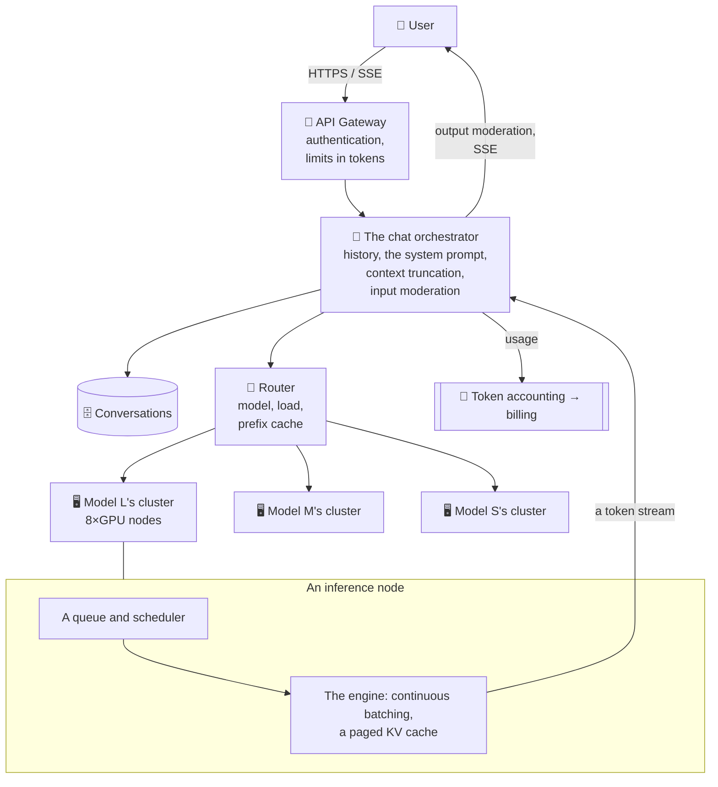
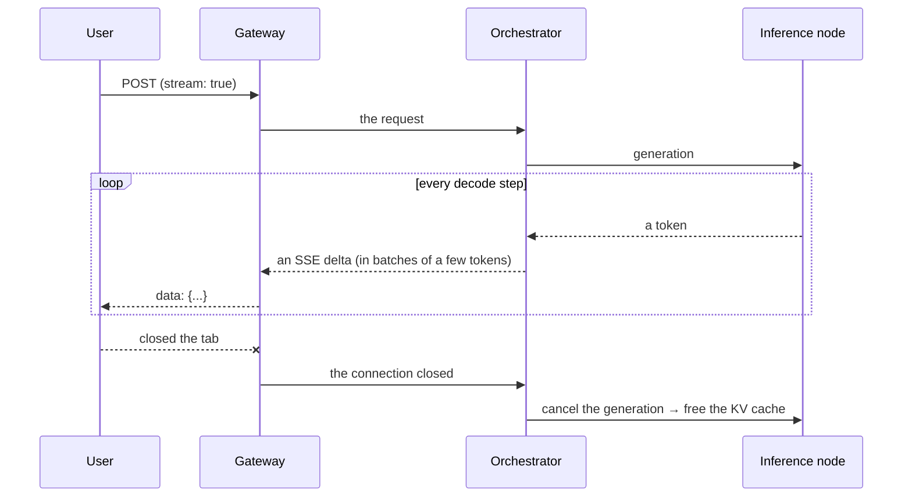

**English** | [Русский](README_RU.md)

# Tier 2 · 4E · 01. An LLM Serving System (like ChatGPT)

> **Level:** Hard · **Interview time:** 45–60 min · **Study time:** ~5–6 h
> **Key aspects:** the prefill and decode phases, why generation is bound by memory bandwidth, the KV cache and its size, PagedAttention, static and continuous batching, request scheduling, token streaming and cancellation, routing that accounts for the prefix cache, model parallelism, quantization and speculative decoding, GPU autoscaling and the cost per token, storing conversations and moderation
> **Builds on:** [12-communication](../../../12-communication/README.md#7-server--client-polling-long-polling-sse-websocket), [Tier 1 · 02 Rate Limiter](../../../tier-1/02-rate-limiter/README.md), [13-reliability-patterns](../../../13-reliability-patterns/README.md), [Tier 2 · 4D · 07 RTB](../../4d-ecommerce-fintech/07-ad-auction-rtb/README.md#6-deep-dive-1-the-latency-budget), [01-scaling-basics](../../../01-scaling-basics/README.md)

---

## 🗺️ How to Read This Walkthrough

The walkthrough follows an interview, but every step includes explanations: **why** a decision is made, **how** a mechanism works and **what happens** if you do it differently. The "📘 Explanation" blocks are theory right where you need it.

| Icon | Meaning |
|:----:|:--------|
| 🎤 | Interviewer |
| 🗣️ | What I (the candidate) say out loud |
| ✏️ | What I draw on the whiteboard |
| ⏱️ | Time budget for the step |
| 📘 | A detailed explanation of a concept |

Callouts: **TIP** — a good technique, **WARNING** — a trap, **IMPORTANT** — a Senior+ signal.

---

## 📑 Contents

0. [What This Problem Teaches](#0-what-this-problem-teaches)
1. [Problem Statement](#1-problem-statement)
2. [Clarifying Questions and Requirements](#2-clarifying-questions-and-requirements)
3. [Capacity Estimates](#3-capacity-estimates)
4. [API](#4-api)
5. [Data Model](#5-data-model)
6. [High-Level Design](#6-high-level-design)
7. [Deep Dive 1: How a Response Is Generated — Prefill and Decode](#7-deep-dive-1-how-a-response-is-generated--prefill-and-decode)
8. [Deep Dive 2: The KV Cache and PagedAttention](#8-deep-dive-2-the-kv-cache-and-pagedattention)
9. [Deep Dive 3: Batching and Scheduling](#9-deep-dive-3-batching-and-scheduling)
10. [Deep Dive 4: Streaming Tokens](#10-deep-dive-4-streaming-tokens)
11. [Deep Dive 5: Routing and the Prefix Cache](#11-deep-dive-5-routing-and-the-prefix-cache)
12. [Deep Dive 6: Large Models — Parallelism, Quantization, Speculative Decoding](#12-deep-dive-6-large-models--parallelism-quantization-speculative-decoding)
13. [Deep Dive 7: Capacity, Autoscaling and Cost](#13-deep-dive-7-capacity-autoscaling-and-cost)
14. [Deep Dive 8: Conversations, Safety and Reliability](#14-deep-dive-8-conversations-safety-and-reliability)
15. [Bottlenecks and Failure Scenarios](#15-bottlenecks-and-failure-scenarios)
16. [What Changes at 10x Scale](#16-what-changes-at-10x-scale)
17. [Key Concepts and New Terms](#17-key-concepts-and-new-terms)
18. [Variations and Follow-Up Questions](#18-variations-and-follow-up-questions)
19. [Common Mistakes](#19-common-mistakes)
20. [Cheat Sheet and Self-Check](#20-cheat-sheet-and-self-check)

---

## 0. What This Problem Teaches

Serving LLMs is the new interview classic: companies ask whether you understand **why** such systems are built differently from ordinary web services. A request lasts not milliseconds but seconds and minutes; the bottleneck isn't the CPU or a database but **GPU memory and memory bandwidth**; one GPU server costs as much as dozens of ordinary ones; and the response is streamed token by token.

| What's tested | Where it shows up |
|:--------------|:------------------|
| Understanding the compute model | Prefill versus decode, where the bottleneck is |
| Memory management | The KV cache, fragmentation, PagedAttention |
| Batching and scheduling | Continuous batching, priorities, admission |
| Streaming | SSE, cancellation, backpressure |
| Stateful routing | The prefix cache, "sticky" conversations |
| Scaling models | Tensor and pipeline parallelism, quantization |
| Economics | The cost per token, GPU utilization |

> [!TIP]
> A strong opening: "Generation has two phases with different bottlenecks: **prefill** is compute-bound, **decode** is bound by reading weights from memory. So the main performance lever is **batching**: one read of the weights serves many requests, and the main constraint on the batch is **memory for the KV cache**." The whole design grows out of that sentence.

---

## 1. Problem Statement

> 🎤 "Design an LLM serving system like ChatGPT: users send messages and receive a streamed response; there are several models of different sizes, conversation history, and per-plan limits. Time to first token, generation speed and cost all matter."

**What the user sees:**

```
Anna sends a question → the first word appears after ~0.5–1 s
The answer "types out" at ~30–60 tokens per second
Anna clicks "Stop" → generation stops immediately
The next question in the same conversation is answered faster (a context cache)
A free-tier user at peak gets a lighter model or a limit
```

**Time plan:**

| Step | ⏱️ |
|:-----|:--:|
| Requirements | 5 min |
| Estimates | 5 min |
| API and data | 4 min |
| High-level design | 5 min |
| Deep dives | 25 min |
| Wrap-up | 3 min |

---

## 2. Clarifying Questions and Requirements

⏱️ 5 min

| My question | Interviewer's answer | What it changes and why |
|:------------|:---------------------|:------------------------|
| Load? | ~200M requests per day, a peak of ~10,000 requests/s | Hundreds of thousands of concurrent generations |
| Request and response size? | ~2,000 input tokens on average (with history), ~500 output | Both prefill and decode matter |
| Models? | Several: from small ones to ~70B+ parameters and beyond | Different clusters, routing |
| Context? | Up to 128K tokens | A huge KV cache for long requests |
| Latency? | Time to first token (TTFT) p50 < 1 s; a speed of ≥ 30 tokens/s per user | A trade-off with the batch size |
| Plans? | Free and paid, with different limits and priority | Priority scheduling, limits in tokens |
| Offline requests? | Yes, a cheaper batch API | Filling idle GPUs |
| Safety? | Moderating input and output | Classifiers in the stream |

### Functional requirements

1. Chat with a streamed response; stopping generation.
2. Several models; chosen by the user or automatically.
3. Conversation history.
4. Per-plan limits (tokens per minute, requests per day).
5. A batch API for offline jobs.
6. Moderation.

### Non-functional requirements

| Requirement | Target | Why |
|:------------|:-------|:----|
| **TTFT** (time to first token) | p50 < 1 s, p99 < 3–5 s | The user sees the system "thinking" |
| **TPOT** (time per output token) | ≤ 20–30 ms (≥ 30–50 tokens/s) | Faster than a person reads |
| Throughput | Millions of tokens per second | Scale |
| GPU utilization | High | GPUs are the main expense |
| Availability | High; degradation instead of failure | A product for hundreds of millions |
| Fairness | Paying users don't suffer because of free ones | Plans |

---

## 3. Capacity Estimates

⏱️ 5 min

```
Requests:        10,000/s at peak
Output tokens:   500 per request at ~50 tokens/s → generation takes ~10 s
Concurrent:      10,000/s × 10 s = 100,000 active generations
Decode:          100,000 × 50 = 5M output tokens/s
Prefill:         10,000 × 2,000 = 20M input tokens/s

The KV cache per token (a Llama 2 70B-class model: 80 layers, 8 KV heads of 128, fp16):
                 2 (K and V) × 80 × 8 × 128 × 2 B = 327,680 B ≈ 320 KB per token
                 a 4K-token sequence ≈ 1.3 GB
A 70B model's weights in fp16: ~140 GB

A node with 8 GPUs × 80 GB = 640 GB:
                 640 − 140 (weights) ≈ 500 GB for the KV cache
                 ≈ 1.5M tokens ≈ ~370 sequences of 4K at once
```

### Conclusions

| Conclusion | Design consequence |
|:-----------|:-------------------|
| The KV cache is gigabytes per request | Memory sets the batch size → an efficient memory manager is needed |
| Hundreds of thousands of concurrent generations | Hundreds to thousands of GPU nodes (the exact number depends on the model and optimizations) |
| Long requests eat memory | Separate pools or limits for long context |
| Repeated prefixes (the system prompt, history) | A prefix cache saves prefill |

> [!NOTE]
> The numbers are approximate and meant for reasoning; real performance depends heavily on the model, hardware, engine and optimizations.

---

## 4. API

⏱️ 2 min

```http
POST /v1/chat/completions
{
  "model": "large-v3", "stream": true, "max_tokens": 1024, "temperature": 0.7,
  "conversation_id": "c_81",
  "messages": [{ "role": "user", "content": "Explain what a KV cache is" }]
}

→ 200 text/event-stream
data: {"id":"gen_9","delta":{"content":"A"}}
data: {"id":"gen_9","delta":{"content":" KV"}}
…
data: {"id":"gen_9","finish_reason":"stop","usage":{"input_tokens":1840,"output_tokens":412}}
data: [DONE]

POST /v1/generations/{id}/cancel     ← or just close the connection
POST /v1/batches                     ← an offline batch: cheaper, completes within 24 h
```

---

## 5. Data Model

⏱️ 2 min

| Data | Store | Why |
|:-----|:------|:----|
| Conversations and messages | A DB sharded by user_id | History, continuing a conversation |
| Token accounting | Counters + an event stream → billing | Limits and payment |
| The model registry | Configuration: versions, clusters, weights | Routing, rolling out versions |
| Model weights | Object storage + nodes' local NVMe caches | Fast loading at node startup |
| The KV cache | GPU memory (temporary), sometimes CPU/SSD | Generation state |
| Prefix cache metadata | In the router's memory | Where to send a request |

---

## 6. High-Level Design

⏱️ 5 min



🗣️ "Key decisions:
- **the gateway** checks access and **limits in tokens** (not just requests);
- **the orchestrator** assembles the context — history, the system prompt, truncation to the window — moderates the input, then proxies the token stream to the client with output moderation;
- **the router** picks the model and node based on load, free memory and **the prefix cache**;
- **inference nodes** are 8-GPU servers; an engine with **continuous batching** and **a paged KV cache** runs hundreds of generations at once;
- token accounting flows as events into billing."

---

## 7. Deep Dive 1: How a Response Is Generated — Prefill and Decode

> 🎤 "Why can't you just add more servers, as for an ordinary API?"

### Two phases

| Phase | What happens | The bottleneck |
|:------|:-------------|:---------------|
| **Prefill** | The whole prompt (2,000 tokens) is processed **in parallel** in one pass; the KV cache is filled | **Compute** (matrix multiplications, the GPU is busy) |
| **Decode** | **One** token per step; each step reads **all** the model's weights and the KV cache | **Memory bandwidth** |

### Why decode is bound by memory

```
A 70B model in fp16 = ~140 GB of weights
A decode step = reading all 140 GB from GPU memory
The HBM bandwidth of one H100-class GPU ≈ 3.35 TB/s; across 8 GPUs ≈ 26.8 TB/s
→ a step ≥ 140 / 26,800 ≈ 5 ms (a theoretical minimum, ignoring everything else)

A single request: ~200 tokens/s at most, with the GPU's compute almost idle
A batch of 64 requests: the weights are read ONCE per step for all 64
→ up to ~12,800 tokens/s per node (theoretically), with almost no increase in step time
```

📘 **The main takeaway:** in the decode phase, step time barely depends on batch size (until compute or memory runs out), while throughput grows in proportion to the batch. So all the optimization is about **keeping the batch large**.

### Metrics

| Metric | What drives it | What improves it |
|:-------|:---------------|:-----------------|
| **TTFT** | The queue + prefill | A shorter queue, the prefix cache, priorities |
| **TPOT** | A decode step | A smaller batch (but throughput drops), speculative decoding, quantization |
| **Throughput** | Tokens/s per node | A larger batch → memory for the KV cache is needed |

> [!IMPORTANT]
> **Senior+ signal:** name the **latency versus throughput** trade-off: a larger batch raises tokens per second per GPU (cheaper), but each step takes slightly longer and new requests' prefill interferes with current requests' decode. The TTFT and TPOT SLOs determine how large the batch can be.

---

## 8. Deep Dive 2: The KV Cache and PagedAttention

> 🎤 "What is the KV cache, and why is it the main memory problem?"

### What it is

📘 For each already-processed token, the model computes the attention keys (K) and values (V) on every layer. To avoid recomputing them at every decode step, they're stored — that's **the KV cache**. It grows by one token per step.

```
KV per token = 2 × layers × KV heads × head size × bytes per number
             = 2 × 80 × 8 × 128 × 2 B ≈ 320 KB        (a 70B-class model with GQA, fp16)
4,000 tokens → ~1.3 GB
128,000 tokens → ~42 GB — more than half of one GPU!
```

📘 **GQA** (grouped-query attention) — several query heads share one K/V pair; this shrinks the KV cache several-fold compared with full multi-head attention (which would have 64 KV heads here instead of 8).

### The fragmentation problem

📘 How many tokens a request will generate isn't known in advance. A naive engine reserves a contiguous block of memory for the **maximum** length (e.g. 4,096 tokens), even if the response takes 300. The vLLM researchers showed that in such systems most of the KV cache memory is wasted on reservations and fragmentation.

### PagedAttention

📘 An idea from OS virtual memory: the KV cache is split into fixed-size **blocks** (e.g. 16 tokens each), allocated as a sequence grows and placeable anywhere in memory. A sequence's **block table** records where its blocks live.

```
Sequence A: blocks [7, 2, 15]       ← logically contiguous, physically scattered
Sequence B: blocks [3, 9]
Free blocks: [1, 4, 5, 6, 8, …]

A new token in A, block 15 is full → allocate block 1 and append it to A's table
```

| Effect | Why it matters |
|:-------|:---------------|
| Almost no wasted memory | Only the last, partially filled block is wasted |
| Several times more concurrent sequences | A larger batch → more tokens/s |
| **Shared blocks** for identical prefixes | The system prompt is stored once for many requests |

### When memory runs out

| Strategy | How |
|:---------|:----|
| **Preemption** | Pause some sequences |
| Swapping to CPU memory | Bring them back later |
| Recomputation | Drop the KV and redo the prefill on resumption |
| Admission | Don't start a new request if memory won't cover its typical length |

---

## 9. Deep Dive 3: Batching and Scheduling

> 🎤 "How do you batch requests that arrive at different times and finish at different times?"

### Static versus continuous batching

```
A static batch (4 requests):
  A: ████████████████████ (500 tokens)
  B: ████ (100) ……………… waits for A to finish
  C: ██████ (150) ……………… waits
  D: ██ (50) ……………………… waits
  New requests wait for the whole batch to end; the GPU idles on the "finished" slots

Continuous batching (iteration-level scheduling):
  at EVERY decode step: finished requests leave, new ones join
  B finished → E takes its place immediately; D finished → F
```

📘 **Continuous batching** (iteration-level scheduling) was described in the Orca paper (2022) and became the standard for engines (vLLM, TensorRT-LLM, TGI): the batch is rebuilt at every step, so the GPU never waits for the longest request.

### Prefill interferes with decode

📘 A new request's long prefill (e.g. 30,000 tokens) occupies the GPU for hundreds of milliseconds — every current generation "freezes" meanwhile, and TPOT spikes.

| Solution | How |
|:---------|:----|
| **Chunked prefill** | A long prefill is split into parts interleaved with decode steps |
| **Disaggregating prefill and decode** | Separate GPU pools for prefill and decode, with the KV cache transferred between them (approaches like DistServe and Splitwise); each pool is optimized for its phase |
| A per-step token budget | The scheduler caps the total prefill tokens in each step |

### The scheduler's policy

| Policy | Why |
|:-------|:----|
| **Per-plan priorities** | Paid requests go first in the queue |
| Memory-based admission | Don't accept if the KV cache won't suffice |
| A queue cap | Better to reject (429) or switch to another model than to wait minutes |
| The batch API — in idle "windows" | Fills the GPUs when interactive load is low |

---

## 10. Deep Dive 4: Streaming Tokens

> 🎤 "How do you deliver tokens to the user as they're generated, and what if the user leaves?"



| Decision | Why |
|:---------|:----|
| **SSE** (or WebSocket) | A server → client stream over ordinary HTTP (see [12-communication](../../../12-communication/README.md#7-server--client-polling-long-polling-sse-websocket)) |
| Sending small batches of tokens | Less overhead, smooth output |
| **Cancelling when the connection closes** | No GPU time is spent on an answer nobody will read |
| Backpressure | A slow client — a buffer in the orchestrator; generation doesn't wait for the client |
| Saving the partial response | On a drop, what was generated can still be shown |
| Long-lived connections | Load balancer and proxy timeouts are configured in minutes |

---

## 11. Deep Dive 5: Routing and the Prefix Cache

> 🎤 "The user asks a fifth question in a conversation. Why process the whole history again?"

### The prefix cache

📘 The fifth question's prompt = the system prompt + 4 previous exchanges + the new question. The earlier parts **were already processed** — their KV cache may still be in the node's memory. If the request lands on the same node, prefill is needed only for the new question.

```
Without the cache: prefill of 6,000 tokens → TTFT ~1.5 s
With the cache:    prefill of 300 new tokens → TTFT ~0.2 s
```

| Decision | How |
|:---------|:----|
| **Pinning a conversation to a node** | Consistent hashing on conversation_id or on a prefix hash |
| A shared system prompt | Held once in memory for every request (PagedAttention's shared blocks) |
| Cache eviction | LRU over prefix blocks |
| **Balancing affinity against load** | If the "home" node is overloaded — send to another, losing the cache |

### Routing

| Signal | Why |
|:-------|:----|
| The model and version | The right cluster |
| Context length | Long requests go to a pool with plenty of spare memory |
| The node's queue depth and free KV cache | The least loaded node |
| A prefix cache hit | Faster TTFT, less compute |
| The plan | Separate pools or priorities |

---

## 12. Deep Dive 6: Large Models — Parallelism, Quantization, Speculative Decoding

> 🎤 "The model doesn't fit on one GPU. And how do you speed up generation?"

### Parallelism

| Kind | How | Where |
|:-----|:----|:------|
| **Tensor parallel** | Each layer is split across GPUs; every layer exchanges data over a fast link (NVLink) | Within a node |
| **Pipeline parallel** | Different layers on different GPUs or nodes | Very large models, across nodes |
| **Expert parallel** | In MoE models, experts are spread across GPUs | Mixture-of-experts models |
| **Replicas** (data parallel) | Many copies of the model | Scaling throughput |

### Quantization

| Format | Effect | Trade-off |
|:-------|:-------|:----------|
| FP16 / BF16 | The baseline | — |
| **FP8** | Weights and the KV cache are 2× smaller → larger batches, faster reads | A small loss of quality; needs hardware support |
| INT4 (weights) | Weights 4× smaller | A more noticeable quality loss; good for small models and offline jobs |

### Speculative decoding

📘 A small "draft" model quickly proposes the next k tokens; the large model **verifies all of them in one pass** (like a prefill). Accepted tokens are emitted immediately; at the first mismatch, generation continues from the correct token.

```
The draft model proposes 4 tokens → the large one verifies them in 1 step
3 of 4 accepted → one large-model step yields 3–4 tokens instead of 1
```

| Pro | Con |
|:----|:----|
| Lower TPOT (fewer large-model steps per token) | Extra compute and memory; the gain shrinks with a large batch and poor agreement |

---

## 13. Deep Dive 7: Capacity, Autoscaling and Cost

> 🎤 "GPUs are expensive and scarce. How do you plan capacity and compute cost?"

### Cold starts

📘 A new node must load ~140 GB of weights and warm up — that takes minutes. "On demand" autoscaling, as for web services, can't keep up with spikes.

| Decision | Why |
|:---------|:----|
| **A warm reserve** of nodes | Instant capacity during a spike |
| Scaling on **the queue and TTFT**, not CPU | GPU utilization doesn't reflect user-facing latency |
| Fast weight loading | Local NVMe caches, parallel loading, weights in a direct-load format |
| Rebalancing between models | Nodes switch to the model with more demand |

### The cost per token

```
Assume (illustratively): an 8×GPU node costs $20 per hour
                         and produces 3,000 output tokens/s with a good batch

Tokens per hour = 3,000 × 3,600 = 10.8M
The cost of 1M output tokens ≈ 20 / 10.8 ≈ $1.85

With a batch half that size (for latency) — the cost is roughly double
```

| Cost lever | How |
|:-----------|:----|
| Batch size | The main lever; bounded by the SLO and memory |
| Quantization | Larger batches, faster |
| The prefix cache | Less prefill |
| **The batch API** | Offline jobs fill nightly dips in load — cheaper for the customer, more profitable for the platform |
| Routing to an appropriately sized model | Simple questions don't need the largest model |

### Limits

📘 Limits are counted **in tokens** (input + output per minute), not requests: a 100,000-token request costs hundreds of times more than a short one (see [Tier 1 · 02](../../../tier-1/02-rate-limiter/README.md)). Output tokens aren't known in advance — `max_tokens` is reserved, and the difference is returned after generation.

---

## 14. Deep Dive 8: Conversations, Safety and Reliability

### Conversations and context

| Decision | Why |
|:---------|:----|
| Conversations — in a DB sharded by user_id | History, syncing across devices |
| **Context truncation** | If the history is longer than the window — drop old parts or replace them with a summary |
| Saving after generation | The user's message before, the response after completion (or a partial one on a drop) |

### Safety

| Measure | How |
|:--------|:----|
| Input moderation | A classifier before sending to the model |
| **Streaming output moderation** | Checking the accumulated text as it's generated; on a violation — stop the stream |
| Limits and anti-abuse | Detecting automated abuse |
| Data isolation | One user's data never ends up in another's context (the prefix cache matches only exact content) |

### Reliability

| Failure | Solution |
|:--------|:---------|
| A GPU error (ECC, a node crash) | Health checks; unfinished generations restart on another node (the response is regenerated) |
| A model cluster is overloaded | A clear error, or switching to a smaller model |
| A slow node | Removed from routing based on latency metrics |

### Metrics

TTFT, TPOT, tokens/s per node, GPU utilization, KV cache usage, queue depth and wait time, the prefix cache hit rate, the share of cancelled generations.

---

## 15. Bottlenecks and Failure Scenarios

| Scenario | What happens | How we protect |
|:---------|:-------------|:---------------|
| A batch of one request | The GPU idles; expensive | Continuous batching |
| The KV cache runs out of memory | Rejections or waiting | PagedAttention, preemption, admission |
| A long prefill | Every generation freezes | Chunked prefill, disaggregating prefill and decode |
| The user left | Wasted GPU time | Cancelling when the connection closes |
| Reprocessing the history | A long TTFT | The prefix cache, conversation affinity |
| A load spike | Nodes take minutes to start | A warm reserve, scaling on the queue |
| Free users crowd out paying ones | SLO violations | Priorities, separate pools |
| A 128K-token request | Occupies half a GPU | A separate pool, limits |
| A node crash | Lost generations | Restarting on another node |
| A violation in a response | Harm to the user | Streaming moderation |

---

## 16. What Changes at 10x Scale

> 🎤 "10× more users?"

| Change | Why |
|:-------|:----|
| **Disaggregating prefill and decode** by default | Each phase on optimal hardware |
| **A hierarchical KV cache** (GPU → CPU → SSD → distributed) | More prefix cache hits |
| **A model cascade** | A small model answers; the large one only for hard requests |
| **Multi-region**, accounting for GPU availability | Capacity wherever the hardware is |

---

## 17. Key Concepts and New Terms

### What's applied

| Concept | Where it's covered | How it applies here |
|:--------|:-------------------|:--------------------|
| SSE and long-lived connections | [12-communication](../../../12-communication/README.md) | Token streaming |
| Limits | [Tier 1 · 02](../../../tier-1/02-rate-limiter/README.md) | Limits in tokens |
| Load shedding, degradation | [13-reliability-patterns](../../../13-reliability-patterns/README.md) | An overloaded cluster |
| A latency budget | [Tier 2 · 4D · 07](../../4d-ecommerce-fintech/07-ad-auction-rtb/README.md) | TTFT and TPOT as SLOs |

### New terms in this problem

| Term | In short |
|:-----|:---------|
| **Prefill and decode** | Processing the prompt in parallel and generating step by step |
| **TTFT, TPOT** | Time to the first token and per subsequent token |
| **The KV cache** | Stored attention keys and values |
| **GQA** | Shared K/V for groups of heads — a smaller KV cache |
| **PagedAttention** | A KV cache in blocks with a block table |
| **Continuous batching** | Rebuilding the batch at every step |
| **Chunked prefill** | A long prefill in parts between decode steps |
| **Disaggregating prefill and decode** | Different GPU pools for different phases |
| **A prefix cache** | Reusing the KV of prompts' shared beginnings |
| **Tensor and pipeline parallelism** | Splitting a model across GPUs |
| **Quantization** | Fewer bits per weight and KV entry |
| **Speculative decoding** | A draft model proposes, the large one verifies |

---

## 18. Variations and Follow-Up Questions

<details>
<summary><b>How do you serve thousands of fine-tuned versions of a model for different customers?</b></summary>

With LoRA adapters: one base model and small adapters (megabytes); the engine keeps many adapters in memory and applies the right one to each request in the batch (approaches like S-LoRA and Punica). Full copies of the model per customer would be unaffordable.
</details>

<details>
<summary><b>How do you add document search (RAG)?</b></summary>

Before generating, the orchestrator searches a vector index for relevant passages and adds them to the prompt. This increases input tokens (prefill), so a prefix cache for shared documents and a cap on the number of passages matter. More in a separate problem in group 4E.
</details>

<details>
<summary><b>How does tool calling (function calling) work?</b></summary>

The model generates a structured call; the orchestrator executes the tool (search, code, an API) and adds the result to the context, and then generation continues. That's several prefill/decode cycles in one response; the KV cache between cycles is worth keeping on the same node.
</details>

<details>
<summary><b>Why not run models on CPUs?</b></summary>

Decode is bound by memory bandwidth, and a CPU's is many times lower than a GPU's HBM; there's not enough compute for prefill either. For very small models and offline jobs CPUs are possible, but not for an interactive service with large models.
</details>

<details>
<summary><b>How do you make a response reproducible?</b></summary>

A fixed seed and temperature = 0 approach determinism, but parallel GPU computation and varying batch composition can produce small numerical differences. For auditing, store the response itself, the model version and the parameters, rather than counting on exact reproduction.
</details>

---

## 19. Common Mistakes

| ❌ Mistake | Why it's bad | ✅ Do this instead |
|:----------|:-------------|:------------------|
| Processing requests one at a time | The GPU idles during decode | Continuous batching |
| A static batch | Waiting for the longest request | Rebuilding the batch at every step |
| Reserving the KV cache for the maximum length | Most memory is wasted | PagedAttention |
| Ignoring prefill's impact on decode | TPOT spikes | Chunked prefill, disaggregating the phases |
| Not cancelling generation when the user leaves | Burned GPU hours | Cancelling when the connection closes |
| Random routing | No prefix cache hits | Conversation affinity, balanced with load |
| Autoscaling like a web service | Nodes take minutes to start | A warm reserve, scaling on the queue |
| Limits in requests | Long requests evade limits | Limits in tokens |
| One model for everything | Expensive for simple requests | Routing by difficulty |
| Moderating only after generation | Harmful text was already shown | Streaming moderation |

---

## 20. Cheat Sheet and Self-Check

### 30-second answer

> Generation = prefill (in parallel over the prompt, compute-bound, drives TTFT) + decode (one token per step, each step reads all the weights — bound by memory bandwidth, drives TPOT). So the main lever is batching: one read of the weights per step serves the whole batch; its size is bounded by memory for the KV cache (~320 KB per token for a 70B-class model with GQA; 4K tokens ≈ 1.3 GB). The engine: PagedAttention (a KV cache in blocks, almost no waste, shared blocks for prefixes), continuous batching (rebuilding the batch every step), chunked prefill or separate prefill and decode pools, preemption when memory runs short. A gateway with limits in tokens → an orchestrator (history, context truncation, input moderation) → a router (model, load, free KV, conversation affinity for the prefix cache) → 8×GPU nodes with tensor parallelism; tokens stream via SSE, with cancellation when the connection closes and streaming output moderation. Quantization (FP8) and speculative decoding for speed. Capacity: a warm reserve, scaling on the queue and TTFT, a batch API for dips in load; the cost per token = the GPU-hour price / tokens per hour, which depends on the batch size.

### Self-check

- [ ] I can explain prefill and decode and their bottlenecks
- [ ] I can compute the minimum decode step time from memory bandwidth
- [ ] I can compute the KV cache size per token and per request
- [ ] I can explain PagedAttention and why it beats naive allocation
- [ ] I can compare static and continuous batching
- [ ] I can explain how prefill interferes with decode, and two solutions
- [ ] I can design streaming with cancellation
- [ ] I can explain the prefix cache and routing for it
- [ ] I can compare kinds of parallelism, quantization and speculative decoding
- [ ] I can compute the cost of a million tokens and name the levers that lower it

### Further reading

- Kwon et al., *Efficient Memory Management for Large Language Model Serving with PagedAttention* (SOSP 2023) — vLLM
- Yu et al., *Orca: A Distributed Serving System for Transformer-Based Generative Models* (OSDI 2022) — continuous batching
- Leviathan et al., *Fast Inference from Transformers via Speculative Decoding* (ICML 2023)
- Zhong et al., *DistServe* (OSDI 2024); Patel et al., *Splitwise* (ISCA 2024) — disaggregating prefill and decode
- Ainslie et al., *GQA: Training Generalized Multi-Query Transformer Models* (2023)
- vLLM, TensorRT-LLM and Hugging Face TGI documentation
