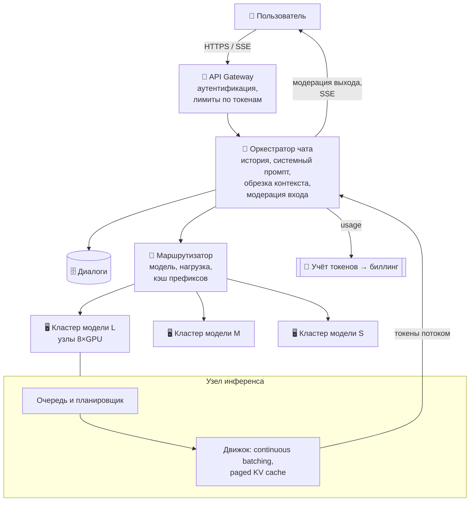
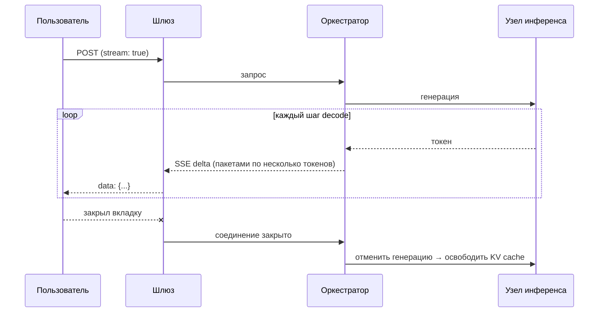

[English](README.md) | **Русский**

# Tier 2 · 4E · 01. Система обслуживания LLM (как ChatGPT)

> **Уровень:** Hard · **Время на интервью:** 45–60 мин · **Время на разбор:** ~5–6 ч
> **Ключевые аспекты:** фазы prefill и decode, почему генерация упирается в пропускную способность памяти, KV cache и его размер, PagedAttention, статический и continuous batching, планирование запросов, стриминг токенов и отмена, маршрутизация с учётом кэша префиксов, параллелизм модели, квантизация и спекулятивное декодирование, автоскейлинг GPU и стоимость токена, хранение диалогов и модерация
> **Опирается на:** [12-communication](../../../12-communication/README_RU.md#7-сервер--клиент-polling-long-polling-sse-websocket), [Tier 1 · 02 Rate Limiter](../../../tier-1/02-rate-limiter/README_RU.md), [13-reliability-patterns](../../../13-reliability-patterns/README_RU.md), [Tier 2 · 4D · 07 RTB](../../4d-ecommerce-fintech/07-ad-auction-rtb/README_RU.md#6-deep-dive-1-бюджет-задержки), [01-scaling-basics](../../../01-scaling-basics/README_RU.md)

---

## 🗺️ Как читать этот разбор

Разбор построен как интервью, но в каждом шаге есть объяснения: **почему** принимается решение, **как работает** механизм и **что будет**, если сделать иначе. Блоки «📘 Объяснение» — теория прямо по ходу задачи.

| Значок | Что значит |
|:------:|:-----------|
| 🎤 | Реплика интервьюера |
| 🗣️ | Что говорю вслух я (кандидат) |
| ✏️ | Что рисую на доске |
| ⏱️ | Сколько времени тратить на шаг |
| 📘 | Подробное объяснение концепции |

Блоки **TIP** — хороший приём, **WARNING** — ловушка, **IMPORTANT** — сигнал для уровня Senior+.

---

## 📑 Содержание

0. [Чему учит эта задача](#0-чему-учит-эта-задача)
1. [Условие задачи](#1-условие-задачи)
2. [Уточняющие вопросы и требования](#2-уточняющие-вопросы-и-требования)
3. [Оценки нагрузки](#3-оценки-нагрузки)
4. [API](#4-api)
5. [Модель данных](#5-модель-данных)
6. [High-level дизайн](#6-high-level-дизайн)
7. [Deep dive 1: как генерируется ответ — prefill и decode](#7-deep-dive-1-как-генерируется-ответ--prefill-и-decode)
8. [Deep dive 2: KV cache и PagedAttention](#8-deep-dive-2-kv-cache-и-pagedattention)
9. [Deep dive 3: batching и планирование](#9-deep-dive-3-batching-и-планирование)
10. [Deep dive 4: стриминг токенов](#10-deep-dive-4-стриминг-токенов)
11. [Deep dive 5: маршрутизация и кэш префиксов](#11-deep-dive-5-маршрутизация-и-кэш-префиксов)
12. [Deep dive 6: большие модели — параллелизм, квантизация, спекулятивное декодирование](#12-deep-dive-6-большие-модели--параллелизм-квантизация-спекулятивное-декодирование)
13. [Deep dive 7: ёмкость, автоскейлинг и стоимость](#13-deep-dive-7-ёмкость-автоскейлинг-и-стоимость)
14. [Deep dive 8: диалоги, безопасность и надёжность](#14-deep-dive-8-диалоги-безопасность-и-надёжность)
15. [Узкие места и сценарии сбоев](#15-узкие-места-и-сценарии-сбоев)
16. [Что изменится при росте в 10 раз](#16-что-изменится-при-росте-в-10-раз)
17. [Ключевые концепции и новые понятия](#17-ключевые-концепции-и-новые-понятия)
18. [Варианты задачи и follow-up вопросы](#18-варианты-задачи-и-follow-up-вопросы)
19. [Типичные ошибки](#19-типичные-ошибки)
20. [Шпаргалка и самопроверка](#20-шпаргалка-и-самопроверка)

---

## 0. Чему учит эта задача

Обслуживание LLM — новая классика интервью: компании спрашивают, понимаешь ли ты, **почему** такие системы устроены иначе, чем обычные веб-сервисы. Запрос длится не миллисекунды, а секунды и минуты; узкое место — не CPU и не база данных, а **память и пропускная способность памяти GPU**; один GPU-сервер стоит как десятки обычных; ответ отдаётся потоком по токену.

| Что проверяют | Где это в задаче |
|:--------------|:-----------------|
| Понимание вычислительной модели | Prefill против decode, где узкое место |
| Управление памятью | KV cache, фрагментация, PagedAttention |
| Batching и планирование | Continuous batching, приоритеты, допуск |
| Стриминг | SSE, отмена, обратное давление |
| Маршрутизация с состоянием | Кэш префиксов, «липкие» диалоги |
| Масштабирование моделей | Тензорный и конвейерный параллелизм, квантизация |
| Экономика | Стоимость токена, загрузка GPU |

> [!TIP]
> Сильное начало: «Генерация состоит из двух фаз с разным узким местом: **prefill** упирается в вычисления, **decode** — в чтение весов из памяти. Поэтому главный рычаг производительности — **batching**: одно чтение весов обслуживает много запросов, а главное ограничение batch'а — **память под KV cache**». Из этой фразы вырастает весь дизайн.

---

## 1. Условие задачи

> 🎤 «Спроектируй систему обслуживания LLM вроде ChatGPT: пользователи отправляют сообщения и получают ответ потоком, есть несколько моделей разного размера, история диалогов, ограничения по тарифам. Важно время до первого токена, скорость генерации и стоимость».

**Что видит пользователь:**

```
Анна отправляет вопрос → через ~0,5–1 с появляется первое слово
Ответ «печатается» со скоростью ~30–60 токенов в секунду
Анна нажимает «Стоп» → генерация прекращается сразу
Следующий вопрос в том же диалоге отвечается быстрее (кэш контекста)
Пользователь бесплатного тарифа в пик получает более лёгкую модель или ограничение
```

**План по времени:**

| Шаг | ⏱️ |
|:----|:--:|
| Требования | 5 мин |
| Оценки | 5 мин |
| API и данные | 4 мин |
| High-level дизайн | 5 мин |
| Deep dives | 25 мин |
| Итоги | 3 мин |

---

## 2. Уточняющие вопросы и требования

⏱️ 5 мин

| Мой вопрос | Ответ интервьюера | Что это меняет и почему |
|:-----------|:------------------|:------------------------|
| Нагрузка? | ~200M запросов в сутки, пик ~10 000 запросов/с | Сотни тысяч одновременных генераций |
| Размер запроса и ответа? | В среднем ~2 000 входных токенов (с историей), ~500 выходных | Prefill и decode оба значимы |
| Модели? | Несколько: от небольших до ~70B+ параметров и больше | Разные кластеры, маршрутизация |
| Контекст? | До 128K токенов | Огромный KV cache для длинных запросов |
| Задержка? | Время до первого токена (TTFT) p50 < 1 с; скорость ≥ 30 токенов/с на пользователя | Компромисс с размером batch'а |
| Тарифы? | Бесплатный и платные с разными лимитами и приоритетом | Планирование по приоритетам, лимиты по токенам |
| Офлайн-запросы? | Да, пакетный API дешевле | Заполнять простаивающие GPU |
| Безопасность? | Модерация входа и выхода | Классификаторы в потоке |

### Функциональные требования

1. Чат с потоковым ответом; остановка генерации.
2. Несколько моделей; выбор пользователем или автоматически.
3. История диалогов.
4. Ограничения по тарифам (токены в минуту, запросы в день).
5. Пакетный API для офлайн-задач.
6. Модерация.

### Нефункциональные требования

| Требование | Цель | Почему |
|:-----------|:-----|:-------|
| **TTFT** (время до первого токена) | p50 < 1 с, p99 < 3–5 с | Пользователь видит, что система «думает» |
| **TPOT** (время на выходной токен) | ≤ 20–30 мс (≥ 30–50 токенов/с) | Быстрее, чем человек читает |
| Пропускная способность | Миллионы токенов в секунду | Масштаб |
| Загрузка GPU | Высокая | GPU — основная статья расходов |
| Доступность | Высокая; деградация вместо отказа | Продукт для сотен миллионов |
| Справедливость | Платные пользователи не страдают от бесплатных | Тарифы |

---

## 3. Оценки нагрузки

⏱️ 5 мин

```
Запросы:         10 000/с в пик
Выходные токены: 500 на запрос при ~50 токенах/с → генерация ~10 с
Одновременно:    10 000/с × 10 с = 100 000 активных генераций
Decode:          100 000 × 50 = 5M выходных токенов/с
Prefill:         10 000 × 2 000 = 20M входных токенов/с

KV cache на токен (модель класса Llama 2 70B: 80 слоёв, 8 KV-голов по 128, fp16):
                 2 (K и V) × 80 × 8 × 128 × 2 Б = 327 680 Б ≈ 320 КБ на токен
                 последовательность 4K токенов ≈ 1,3 ГБ
Веса модели 70B в fp16: ~140 ГБ

Узел 8 × GPU по 80 ГБ = 640 ГБ:
                 640 − 140 (веса) ≈ 500 ГБ под KV cache
                 ≈ 1,5M токенов ≈ ~370 последовательностей по 4K одновременно
```

### Выводы

| Вывод | Следствие для дизайна |
|:------|:----------------------|
| KV cache — гигабайты на запрос | Память определяет размер batch'а → нужен эффективный менеджер памяти |
| Сотни тысяч одновременных генераций | Сотни–тысячи GPU-узлов (точное число зависит от модели и оптимизаций) |
| Длинные запросы съедают память | Отдельные пулы или лимиты для длинного контекста |
| Повторяющиеся префиксы (системный промпт, история) | Кэш префиксов экономит prefill |

> [!NOTE]
> Числа приблизительные и служат для рассуждения; реальная производительность сильно зависит от модели, железа, движка и оптимизаций.

---

## 4. API

⏱️ 2 мин

```http
POST /v1/chat/completions
{
  "model": "large-v3", "stream": true, "max_tokens": 1024, "temperature": 0.7,
  "conversation_id": "c_81",
  "messages": [{ "role": "user", "content": "Объясни, что такое KV cache" }]
}

→ 200 text/event-stream
data: {"id":"gen_9","delta":{"content":"KV"}}
data: {"id":"gen_9","delta":{"content":" cache"}}
…
data: {"id":"gen_9","finish_reason":"stop","usage":{"input_tokens":1840,"output_tokens":412}}
data: [DONE]

POST /v1/generations/{id}/cancel     ← или просто закрыть соединение
POST /v1/batches                     ← офлайн-пакет: дешевле, выполнение до 24 ч
```

---

## 5. Модель данных

⏱️ 2 мин

| Данные | Хранилище | Почему |
|:-------|:----------|:-------|
| Диалоги и сообщения | Шардированная БД по user_id | История, продолжение диалога |
| Учёт токенов | Счётчики + поток событий → биллинг | Лимиты и оплата |
| Реестр моделей | Конфигурация: версии, кластеры, веса | Маршрутизация, выпуск версий |
| Веса моделей | Объектное хранилище + локальные NVMe-кэши узлов | Быстрая загрузка при старте узла |
| KV cache | Память GPU (временно), иногда CPU/SSD | Состояние генерации |
| Метаданные кэша префиксов | В памяти маршрутизатора | Куда направить запрос |

---

## 6. High-level дизайн

⏱️ 5 мин



🗣️ «Ключевые решения:
- **шлюз** проверяет доступ и **лимиты в токенах** (а не только в запросах);
- **оркестратор** собирает контекст — история, системный промпт, обрезка до окна, — модерирует вход, а потом проксирует поток токенов клиенту с модерацией выхода;
- **маршрутизатор** выбирает модель и узел с учётом нагрузки, свободной памяти и **кэша префиксов**;
- **узлы инференса** — серверы с 8 GPU; движок с **continuous batching** и **paged KV cache** держит сотни генераций одновременно;
- учёт токенов идёт событиями в биллинг».

---

## 7. Deep dive 1: как генерируется ответ — prefill и decode

> 🎤 «Почему нельзя просто поставить больше серверов, как для обычного API?»

### Две фазы

| Фаза | Что происходит | Узкое место |
|:-----|:---------------|:------------|
| **Prefill** | Весь промпт (2 000 токенов) обрабатывается **параллельно** за один проход; заполняется KV cache | **Вычисления** (матричные умножения, GPU загружен) |
| **Decode** | По **одному** токену за шаг; каждый шаг читает **все веса** модели и KV cache | **Пропускная способность памяти** |

### Почему decode упирается в память

```
Модель 70B в fp16 = ~140 ГБ весов
Шаг decode = прочитать все 140 ГБ из памяти GPU
Пропускная способность HBM у одного GPU класса H100 ≈ 3,35 ТБ/с, у 8 GPU ≈ 26,8 ТБ/с
→ шаг ≥ 140 / 26 800 ≈ 5 мс (теоретический минимум, без учёта всего остального)

Один запрос: ~200 токенов/с максимум, GPU почти простаивает по вычислениям
Batch из 64 запросов: веса читаются ОДИН раз на шаг для всех 64
→ до ~12 800 токенов/с на узел (теоретически), почти без роста времени шага
```

📘 **Главный вывод:** в фазе decode время шага почти не зависит от размера batch'а (пока не упрёмся в вычисления или память), а пропускная способность растёт пропорционально batch'у. Поэтому вся оптимизация — о том, **как держать batch большим**.

### Метрики

| Метрика | Что определяет | Чем улучшается |
|:--------|:---------------|:---------------|
| **TTFT** | Очередь + prefill | Меньше очередь, кэш префиксов, приоритеты |
| **TPOT** | Шаг decode | Меньше batch (но падает пропускная способность), спекулятивное декодирование, квантизация |
| **Пропускная способность** | Токены/с на узел | Больше batch → нужна память под KV cache |

> [!IMPORTANT]
> **Сигнал Senior+:** назвать компромисс **задержка против пропускной способности**: больший batch повышает токены в секунду на GPU (дешевле), но каждый шаг немного дольше и prefill новых запросов мешает decode текущих. SLO по TTFT и TPOT определяют, насколько большим можно делать batch.

---

## 8. Deep dive 2: KV cache и PagedAttention

> 🎤 «Что такое KV cache и почему он — главная проблема памяти?»

### Что это

📘 Для каждого уже обработанного токена модель вычисляет ключи (K) и значения (V) внимания на каждом слое. Чтобы не пересчитывать их на каждом шаге decode, их хранят — это **KV cache**. Он растёт на один токен за шаг.

```
KV на токен = 2 × слои × KV-головы × размер головы × байт на число
            = 2 × 80 × 8 × 128 × 2 Б ≈ 320 КБ        (модель класса 70B с GQA, fp16)
4 000 токенов → ~1,3 ГБ
128 000 токенов → ~42 ГБ — больше половины одного GPU!
```

📘 **GQA** (grouped-query attention) — несколько голов запросов делят одну пару K/V; это уменьшает KV cache в разы по сравнению с полным multi-head attention (у которого здесь было бы 64 KV-головы вместо 8).

### Проблема фрагментации

📘 Заранее неизвестно, сколько токенов сгенерирует запрос. Наивный движок резервирует непрерывный блок памяти на **максимальную** длину (например, 4 096 токенов), даже если ответ займёт 300. Исследователи vLLM показали, что в таких системах большая часть памяти под KV cache пропадает из-за резервирования и фрагментации.

### PagedAttention

📘 Идея из виртуальной памяти ОС: KV cache делится на **блоки** фиксированного размера (например, по 16 токенов), которые выделяются по мере роста последовательности и могут лежать в памяти где угодно. **Таблица блоков** последовательности указывает, где лежат её блоки.

```
Последовательность A: блоки [7, 2, 15]       ← логически подряд, физически вразброс
Последовательность B: блоки [3, 9]
Свободные блоки: [1, 4, 5, 6, 8, …]

Новый токен у A, блок 15 заполнен → выделить блок 1, дописать в таблицу A
```

| Эффект | Почему важно |
|:-------|:-------------|
| Почти нет потерь памяти | Потеря — только в последнем неполном блоке |
| В разы больше одновременных последовательностей | Больше batch → больше токенов/с |
| **Общие блоки** для одинаковых префиксов | Системный промпт хранится один раз для многих запросов |

### Если память кончилась

| Стратегия | Как |
|:----------|:----|
| **Вытеснение** (preemption) | Приостановить часть последовательностей |
| Выгрузка в память CPU | Вернуть позже |
| Пересчёт | Удалить KV и заново выполнить prefill при возобновлении |
| Допуск | Не начинать новый запрос, если памяти не хватит на его типичную длину |

---

## 9. Deep dive 3: batching и планирование

> 🎤 «Как объединять запросы в batch, если они приходят в разное время и заканчиваются в разное время?»

### Статический против continuous batching

```
Статический batch (4 запроса):
  A: ████████████████████ (500 токенов)
  B: ████ (100) ……………… ждёт, пока закончит A
  C: ██████ (150) ……………… ждёт
  D: ██ (50) ……………………… ждёт
  Новые запросы ждут окончания всего batch'а; GPU простаивает на «закончившихся»

Continuous batching (итерационное планирование):
  на КАЖДОМ шаге decode: закончившиеся выходят, новые входят
  B закончил → на его место сразу E; D закончил → F
```

📘 **Continuous batching** (итерационное планирование) описан в работе Orca (2022) и стал стандартом движков (vLLM, TensorRT-LLM, TGI): batch пересобирается на каждом шаге, GPU не ждёт самого длинного запроса.

### Prefill мешает decode

📘 Длинный prefill нового запроса (например, 30 000 токенов) занимает GPU на сотни миллисекунд — все текущие генерации в это время «замирают», и TPOT резко растёт.

| Решение | Как |
|:--------|:----|
| **Chunked prefill** | Длинный prefill делится на части и перемежается с шагами decode |
| **Разделение prefill и decode** | Отдельные пулы GPU для prefill и для decode, KV cache передаётся между ними (подходы вроде DistServe, Splitwise); каждый пул оптимизирован под свою фазу |
| Ограничение токенов на шаг | Планировщик ограничивает суммарные токены prefill в каждом шаге |

### Политика планировщика

| Политика | Зачем |
|:---------|:------|
| **Приоритеты по тарифу** | Платные запросы раньше в очереди |
| Допуск по памяти | Не принимать, если не хватит KV cache |
| Ограничение очереди | Лучше отказать (429) или переключить на другую модель, чем ждать минуты |
| Пакетный API — в «окна» простоя | Заполняет GPU, когда интерактивной нагрузки мало |

---

## 10. Deep dive 4: стриминг токенов

> 🎤 «Как доставить токены пользователю по мере генерации и что делать, если пользователь ушёл?»



| Решение | Почему |
|:--------|:-------|
| **SSE** (или WebSocket) | Поток сервер → клиент по обычному HTTP (см. [12-communication](../../../12-communication/README_RU.md#7-сервер--клиент-polling-long-polling-sse-websocket)) |
| Отправка небольшими пакетами токенов | Меньше накладных расходов, плавный вывод |
| **Отмена при закрытии соединения** | GPU не тратится на ответ, который никто не прочитает |
| Обратное давление | Медленный клиент — буфер в оркестраторе; генерация не ждёт клиента |
| Сохранение частичного ответа | При обрыве можно показать то, что успело сгенерироваться |
| Длинные соединения | Таймауты балансировщиков и прокси настроены на минуты |

---

## 11. Deep dive 5: маршрутизация и кэш префиксов

> 🎤 «Пользователь задаёт пятый вопрос в диалоге. Зачем снова обрабатывать всю историю?»

### Кэш префиксов

📘 Промпт пятого вопроса = системный промпт + 4 предыдущих обмена + новый вопрос. Первые части **уже обрабатывались** — их KV cache мог остаться в памяти узла. Если запрос попадёт на тот же узел, prefill нужен только для нового вопроса.

```
Без кэша:  prefill 6 000 токенов → TTFT ~1,5 с
С кэшем:   prefill 300 новых токенов → TTFT ~0,2 с
```

| Решение | Как |
|:--------|:----|
| **Привязка диалога к узлу** | Consistent hashing по conversation_id или по хэшу префикса |
| Общий системный промпт | Один раз в памяти для всех запросов (общие блоки PagedAttention) |
| Вытеснение кэша | LRU по блокам префиксов |
| **Баланс привязки и нагрузки** | Если «свой» узел перегружен — отправить на другой, потеряв кэш |

### Маршрутизация

| Сигнал | Зачем |
|:-------|:------|
| Модель и версия | Нужный кластер |
| Длина контекста | Длинные запросы — в пул с большим запасом памяти |
| Глубина очереди и свободный KV cache узла | Наименее загруженный узел |
| Попадание в кэш префиксов | Быстрее TTFT, меньше вычислений |
| Тариф | Отдельные пулы или приоритеты |

---

## 12. Deep dive 6: большие модели — параллелизм, квантизация, спекулятивное декодирование

> 🎤 «Модель не помещается в один GPU. И как ускорить генерацию?»

### Параллелизм

| Вид | Как | Где |
|:----|:----|:----|
| **Тензорный** (tensor parallel) | Каждый слой делится между GPU; на каждом слое — обмен через быструю связь (NVLink) | Внутри узла |
| **Конвейерный** (pipeline parallel) | Разные слои на разных GPU или узлах | Очень большие модели, между узлами |
| **Экспертный** (expert parallel) | В MoE-моделях эксперты распределены по GPU | Модели со смесью экспертов |
| **Реплики** (data parallel) | Много копий модели | Масштабирование пропускной способности |

### Квантизация

| Формат | Эффект | Компромисс |
|:-------|:-------|:-----------|
| FP16 / BF16 | База | — |
| **FP8** | Веса и KV cache в 2 раза меньше → больше batch, быстрее чтение | Небольшая потеря качества, нужна поддержка железа |
| INT4 (веса) | В 4 раза меньше весов | Заметнее потеря качества; хорошо для небольших и офлайн-задач |

### Спекулятивное декодирование

📘 Маленькая «черновая» модель быстро предлагает k следующих токенов; большая модель **проверяет их все за один проход** (как prefill). Принятые токены выдаются сразу; при первом несовпадении — продолжение с правильного токена.

```
Черновая модель предлагает 4 токена → большая проверяет за 1 шаг
Принято 3 из 4 → за один шаг большой модели получено 3–4 токена вместо 1
```

| Плюс | Минус |
|:-----|:------|
| Ниже TPOT (меньше шагов большой модели на токен) | Дополнительные вычисления и память; выигрыш падает при большом batch'е и плохом совпадении |

---

## 13. Deep dive 7: ёмкость, автоскейлинг и стоимость

> 🎤 «GPU дорогие и дефицитные. Как планировать ёмкость и считать стоимость?»

### Холодный старт

📘 Новый узел должен загрузить ~140 ГБ весов и прогреться — это минуты. Автоскейлинг «по запросу», как у веб-сервисов, не успевает за всплесками.

| Решение | Почему |
|:--------|:-------|
| **Тёплый резерв** узлов | Мгновенная ёмкость при всплеске |
| Масштабирование по **очереди и TTFT**, а не по CPU | Загрузка GPU не отражает задержку пользователя |
| Быстрая загрузка весов | Локальные NVMe-кэши, параллельная загрузка, веса в формате для прямой загрузки |
| Перераспределение между моделями | Узлы переключаются на модель с большим спросом |

### Стоимость токена

```
Предположим (иллюстративно): узел 8×GPU стоит 20 $ в час,
                              даёт 3 000 выходных токенов/с при хорошем batch'е

Токенов в час = 3 000 × 3 600 = 10,8M
Стоимость 1M выходных токенов ≈ 20 / 10,8 ≈ 1,85 $

При batch'е вдвое меньше (ради задержки) — стоимость примерно вдвое выше
```

| Рычаг стоимости | Как |
|:----------------|:----|
| Размер batch'а | Главный рычаг; ограничен SLO и памятью |
| Квантизация | Больше batch, быстрее |
| Кэш префиксов | Меньше prefill |
| **Пакетный API** | Офлайн-задачи заполняют ночные провалы нагрузки — дешевле для клиента, выгоднее для платформы |
| Маршрутизация на модель подходящего размера | Простые вопросы не требуют самой большой модели |

### Лимиты

📘 Лимиты считаются **в токенах** (входные + выходные в минуту), а не в запросах: запрос на 100 000 токенов стоит в сотни раз дороже короткого (см. [Tier 1 · 02](../../../tier-1/02-rate-limiter/README_RU.md)). Выходные токены заранее неизвестны — резервируется `max_tokens`, разница возвращается после генерации.

---

## 14. Deep dive 8: диалоги, безопасность и надёжность

### Диалоги и контекст

| Решение | Почему |
|:--------|:-------|
| Диалоги — в шардированной БД по user_id | История, синхронизация между устройствами |
| **Обрезка контекста** | Если история длиннее окна — убрать старое или заменить кратким пересказом |
| Сохранение после генерации | Сообщение пользователя — до, ответ — после завершения (или частичный при обрыве) |

### Безопасность

| Мера | Как |
|:-----|:----|
| Модерация входа | Классификатор до отправки в модель |
| **Потоковая модерация выхода** | Проверка накопленного текста по мере генерации; при нарушении — остановить поток |
| Лимиты и антиабьюз | Обнаружение автоматизированных злоупотреблений |
| Изоляция данных | Данные одних пользователей никогда не попадают в контекст других (кэш префиксов — только по точному совпадению содержимого) |

### Надёжность

| Сбой | Решение |
|:-----|:--------|
| Ошибка GPU (ECC, падение узла) | Проверки здоровья; незавершённые генерации перезапускаются на другом узле (ответ генерируется заново) |
| Перегрузка кластера модели | Отказ с понятной ошибкой или переключение на меньшую модель |
| Медленный узел | Исключение из маршрутизации по метрикам задержки |

### Метрики

TTFT, TPOT, токены/с на узел, загрузка GPU, использование KV cache, глубина и время очереди, доля попаданий в кэш префиксов, доля отменённых генераций.

---

## 15. Узкие места и сценарии сбоев

| Сценарий | Что произойдёт | Как защищаемся |
|:---------|:---------------|:---------------|
| Batch из одного запроса | GPU простаивает, дорого | Continuous batching |
| Память KV cache кончилась | Отказы или ожидание | PagedAttention, вытеснение, допуск |
| Длинный prefill | Все генерации замирают | Chunked prefill, разделение prefill и decode |
| Пользователь ушёл | GPU тратится впустую | Отмена при закрытии соединения |
| Повторная обработка истории | Долгий TTFT | Кэш префиксов, привязка диалога |
| Всплеск нагрузки | Узлы стартуют минуты | Тёплый резерв, масштабирование по очереди |
| Бесплатные пользователи вытесняют платных | Нарушение SLO | Приоритеты, отдельные пулы |
| Запрос на 128K токенов | Занимает пол-GPU | Отдельный пул, лимиты |
| Падение узла | Потеря генераций | Перезапуск на другом узле |
| Нарушение в ответе | Вред пользователю | Потоковая модерация |

---

## 16. Что изменится при росте в 10 раз

> 🎤 «В 10 раз больше пользователей?»

| Изменение | Почему |
|:----------|:-------|
| **Разделение prefill и decode** по умолчанию | Каждая фаза на оптимальном железе |
| **Иерархический кэш KV** (GPU → CPU → SSD → распределённый) | Больше попаданий в кэш префиксов |
| **Каскад моделей** | Маленькая модель отвечает, большая — только для сложных запросов |
| **Мульти-регион** с учётом доступности GPU | Ёмкость там, где есть железо |

---

## 17. Ключевые концепции и новые понятия

### Что применяется

| Концепция | Где разобрана | Как применяется здесь |
|:----------|:--------------|:----------------------|
| SSE и долгие соединения | [12-communication](../../../12-communication/README_RU.md) | Стриминг токенов |
| Лимиты | [Tier 1 · 02](../../../tier-1/02-rate-limiter/README_RU.md) | Лимиты в токенах |
| Load shedding, деградация | [13-reliability-patterns](../../../13-reliability-patterns/README_RU.md) | Перегрузка кластера |
| Бюджет задержки | [Tier 2 · 4D · 07](../../4d-ecommerce-fintech/07-ad-auction-rtb/README_RU.md) | TTFT и TPOT как SLO |

### Новые понятия этой задачи

| Понятие | Кратко |
|:--------|:-------|
| **Prefill и decode** | Параллельная обработка промпта и пошаговая генерация |
| **TTFT, TPOT** | Время до первого токена и на каждый следующий |
| **KV cache** | Сохранённые ключи и значения внимания |
| **GQA** | Общие K/V для групп голов — меньше KV cache |
| **PagedAttention** | KV cache блоками с таблицей блоков |
| **Continuous batching** | Пересборка batch'а на каждом шаге |
| **Chunked prefill** | Длинный prefill частями между шагами decode |
| **Разделение prefill и decode** | Разные пулы GPU для разных фаз |
| **Кэш префиксов** | Повторное использование KV общих начал промптов |
| **Тензорный и конвейерный параллелизм** | Деление модели между GPU |
| **Квантизация** | Меньше бит на вес и KV |
| **Спекулятивное декодирование** | Черновая модель предлагает, большая проверяет |

---

## 18. Варианты задачи и follow-up вопросы

<details>
<summary><b>Как обслуживать тысячи дообученных версий модели для разных клиентов?</b></summary>

Через адаптеры LoRA: базовая модель одна, адаптеры маленькие (мегабайты); движок держит много адаптеров в памяти и применяет нужный к каждому запросу в batch'е (подходы вроде S-LoRA, Punica). Полные копии модели на каждого клиента были бы неподъёмны.
</details>

<details>
<summary><b>Как добавить поиск по документам (RAG)?</b></summary>

Оркестратор перед генерацией ищет релевантные фрагменты в векторном индексе и добавляет их в промпт. Это увеличивает входные токены (prefill), поэтому важны кэш префиксов для общих документов и ограничение числа фрагментов. Подробнее — в отдельной задаче группы 4E.
</details>

<details>
<summary><b>Как работают вызовы инструментов (function calling)?</b></summary>

Модель генерирует структурированный вызов; оркестратор выполняет инструмент (поиск, код, API) и добавляет результат в контекст, затем генерация продолжается. Это несколько циклов prefill/decode в одном ответе; KV cache между циклами стоит сохранять на том же узле.
</details>

<details>
<summary><b>Почему бы не запускать модели на CPU?</b></summary>

Decode упирается в пропускную способность памяти, а у CPU она в разы ниже, чем у HBM на GPU; вычислений для prefill тоже не хватает. Для очень маленьких моделей и офлайн-задач CPU возможен, но для интерактивного сервиса больших моделей — нет.
</details>

<details>
<summary><b>Как обеспечить воспроизводимость ответа?</b></summary>

Фиксированный seed и temperature = 0 приближают детерминированность, но параллельные вычисления на GPU и разный состав batch'а могут давать небольшие числовые различия. Для аудита сохраняют сам ответ, версию модели и параметры, а не рассчитывают на точное воспроизведение.
</details>

---

## 19. Типичные ошибки

| ❌ Ошибка | Почему плохо | ✅ Как правильно |
|:---------|:-------------|:----------------|
| Обрабатывать запросы по одному | GPU простаивает в decode | Continuous batching |
| Статический batch | Ожидание самого длинного запроса | Пересборка batch'а на каждом шаге |
| Резервировать KV cache на максимальную длину | Большая часть памяти теряется | PagedAttention |
| Игнорировать влияние prefill на decode | Скачки TPOT | Chunked prefill, разделение фаз |
| Не отменять генерацию при уходе пользователя | Сожжённые GPU-часы | Отмена при закрытии соединения |
| Случайная маршрутизация | Нет попаданий в кэш префиксов | Привязка диалога с учётом нагрузки |
| Автоскейлинг как у веб-сервисов | Узлы стартуют минуты | Тёплый резерв, масштабирование по очереди |
| Лимиты в запросах | Длинные запросы обходят лимиты | Лимиты в токенах |
| Одна модель для всего | Дорого для простых запросов | Маршрутизация по сложности |
| Модерация только после генерации | Вредный текст уже показан | Потоковая модерация |

---

## 20. Шпаргалка и самопроверка

### Ответ за 30 секунд

> Генерация = prefill (параллельно по промпту, упирается в вычисления, определяет TTFT) + decode (по токену за шаг, каждый шаг читает все веса — упирается в пропускную способность памяти, определяет TPOT). Поэтому главный рычаг — batching: одно чтение весов на шаг обслуживает весь batch; его размер ограничен памятью под KV cache (~320 КБ на токен у модели класса 70B с GQA; 4K токенов ≈ 1,3 ГБ). Движок: PagedAttention (KV cache блоками, почти без потерь, общие блоки для префиксов), continuous batching (пересборка batch'а на каждом шаге), chunked prefill или разделение пулов prefill и decode, вытеснение при нехватке памяти. Шлюз с лимитами в токенах → оркестратор (история, обрезка контекста, модерация входа) → маршрутизатор (модель, нагрузка, свободный KV, привязка диалога для кэша префиксов) → узлы 8×GPU с тензорным параллелизмом; токены потоком через SSE, отмена при закрытии соединения, потоковая модерация выхода. Квантизация (FP8) и спекулятивное декодирование для скорости. Ёмкость: тёплый резерв, масштабирование по очереди и TTFT, пакетный API для провалов нагрузки; стоимость токена = цена GPU-часа / токены в час, зависит от размера batch'а.

### Самопроверка

- [ ] Могу объяснить prefill и decode и их узкие места
- [ ] Могу посчитать минимальное время шага decode по пропускной способности памяти
- [ ] Могу посчитать размер KV cache на токен и на запрос
- [ ] Могу объяснить PagedAttention и чем он лучше наивного выделения
- [ ] Могу сравнить статический и continuous batching
- [ ] Могу объяснить, как prefill мешает decode, и два решения
- [ ] Могу спроектировать стриминг с отменой
- [ ] Могу объяснить кэш префиксов и маршрутизацию для него
- [ ] Могу сравнить виды параллелизма, квантизацию и спекулятивное декодирование
- [ ] Могу посчитать стоимость миллиона токенов и назвать рычаги её снижения

### Что почитать

- Kwon et al., *Efficient Memory Management for Large Language Model Serving with PagedAttention* (SOSP 2023) — vLLM
- Yu et al., *Orca: A Distributed Serving System for Transformer-Based Generative Models* (OSDI 2022) — continuous batching
- Leviathan et al., *Fast Inference from Transformers via Speculative Decoding* (ICML 2023)
- Zhong et al., *DistServe* (OSDI 2024); Patel et al., *Splitwise* (ISCA 2024) — разделение prefill и decode
- Ainslie et al., *GQA: Training Generalized Multi-Query Transformer Models* (2023)
- Документация vLLM, TensorRT-LLM, Hugging Face TGI
