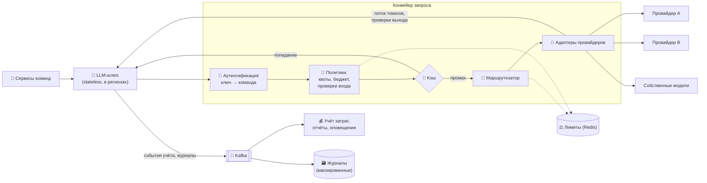
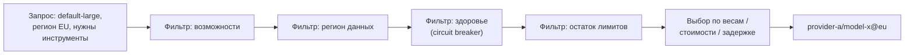

[English](README.md) | **Русский**

# Tier 2 · 4E · 02. LLM-шлюз / роутер

> **Уровень:** Medium · **Время на интервью:** 45 мин · **Время на разбор:** ~3–4 ч
> **Ключевые аспекты:** единый API поверх разных провайдеров, псевдонимы моделей, политики маршрутизации (стоимость, задержка, возможности, качество, локализация данных), повторы и fallback (в том числе при стриминге), лимиты провайдеров и квоты команд в токенах, точный и семантический кэш, учёт затрат и распределение их по командам, журналирование с маскированием данных, защитные проверки, надёжность самого шлюза
> **Опирается на:** [Tier 2 · 4E · 01 LLM Serving](../01-llm-serving/README_RU.md#13-deep-dive-7-ёмкость-автоскейлинг-и-стоимость), [Tier 1 · 02 Rate Limiter](../../../tier-1/02-rate-limiter/README_RU.md), [13-reliability-patterns](../../../13-reliability-patterns/README_RU.md), [Tier 1 · 03 Distributed Cache](../../../tier-1/03-distributed-cache/README_RU.md), [Tier 1 · 17 Ad Click Aggregator](../../../tier-1/17-ad-click-aggregator/README_RU.md)

---

## 🗺️ Как читать этот разбор

Разбор построен как интервью, но в каждом шаге есть объяснения: **почему** принимается решение, **как работает** механизм и **что будет**, если сделать иначе. Блоки «📘 Объяснение» — теория прямо по ходу задачи.

| Значок | Что значит |
|:------:|:-----------|
| 🎤 | Реплика интервьюера |
| 🗣️ | Что говорю вслух я (кандидат) |
| ✏️ | Что рисую на доске |
| ⏱️ | Сколько времени тратить на шаг |
| 📘 | Подробное объяснение концепции |

Блоки **TIP** — хороший приём, **WARNING** — ловушка, **IMPORTANT** — сигнал для уровня Senior+.

---

## 📑 Содержание

0. [Чему учит эта задача](#0-чему-учит-эта-задача)
1. [Условие задачи](#1-условие-задачи)
2. [Уточняющие вопросы и требования](#2-уточняющие-вопросы-и-требования)
3. [Оценки нагрузки](#3-оценки-нагрузки)
4. [API](#4-api)
5. [Модель данных](#5-модель-данных)
6. [High-level дизайн](#6-high-level-дизайн)
7. [Deep dive 1: единый API и адаптеры провайдеров](#7-deep-dive-1-единый-api-и-адаптеры-провайдеров)
8. [Deep dive 2: политики маршрутизации](#8-deep-dive-2-политики-маршрутизации)
9. [Deep dive 3: повторы и fallback](#9-deep-dive-3-повторы-и-fallback)
10. [Deep dive 4: лимиты провайдеров и квоты команд](#10-deep-dive-4-лимиты-провайдеров-и-квоты-команд)
11. [Deep dive 5: кэширование](#11-deep-dive-5-кэширование)
12. [Deep dive 6: учёт затрат](#12-deep-dive-6-учёт-затрат)
13. [Deep dive 7: журналирование, наблюдаемость и защитные проверки](#13-deep-dive-7-журналирование-наблюдаемость-и-защитные-проверки)
14. [Deep dive 8: надёжность самого шлюза](#14-deep-dive-8-надёжность-самого-шлюза)
15. [Узкие места и сценарии сбоев](#15-узкие-места-и-сценарии-сбоев)
16. [Что изменится при росте в 10 раз](#16-что-изменится-при-росте-в-10-раз)
17. [Ключевые концепции и новые понятия](#17-ключевые-концепции-и-новые-понятия)
18. [Варианты задачи и follow-up вопросы](#18-варианты-задачи-и-follow-up-вопросы)
19. [Типичные ошибки](#19-типичные-ошибки)
20. [Шпаргалка и самопроверка](#20-шпаргалка-и-самопроверка)

---

## 0. Чему учит эта задача

Когда LLM используют сотни команд компании, каждая обращается к провайдерам по-своему: свои ключи, свои повторы, нет общего учёта расходов, данные пользователей уходят наружу без контроля. **LLM-шлюз** — центральный прокси, который даёт всем одно API, сам выбирает провайдера и модель, переживает их сбои, считает каждый токен и каждый доллар и следит за безопасностью данных.

Задача похожа на классический API-шлюз, но с особенностями LLM: ответы **дорогие**, **долгие**, идут **потоком**, **недетерминированы**, а лимиты провайдеров считаются **в токенах**.

| Что проверяют | Где это в задаче |
|:--------------|:-----------------|
| Абстракция над внешними API | Единая схема, адаптеры |
| Политики и маршрутизация | Стоимость, задержка, возможности, качество |
| Отказоустойчивость при внешних зависимостях | Повторы, fallback, circuit breaker |
| Распределённые лимиты | Токены в минуту у провайдеров и квоты команд |
| Кэширование с подвохом | Семантический кэш и риски |
| Учёт и аналитика | Затраты по командам |
| Безопасность данных | Маскирование, хранение ключей, локализация |

> [!TIP]
> Сформулируй ценность шлюза тремя словами: **надёжность, контроль затрат, безопасность**. Каждый deep dive отвечает на одно из них.

---

## 1. Условие задачи

> 🎤 «В компании 500 команд и сервисов используют LLM разных провайдеров (OpenAI, Anthropic, Google, собственные модели). Спроектируй шлюз, через который пойдут все запросы: единый API, маршрутизация, отказоустойчивость, лимиты, кэш, учёт затрат по командам».

**Сценарии:**

```
Сервис поддержки вызывает модель «default-large» — шлюз сам выбирает провайдера
У провайдера A сбой → запросы уходят к эквивалентной модели провайдера B без изменений в сервисах
Команда «Маркетинг» исчерпала месячный бюджет → новые запросы отклоняются с понятной ошибкой
Бот FAQ получает тот же вопрос тысячу раз в день → ответ из кэша, без затрат
Финансы видят расходы по каждой команде и модели
```

**План по времени:**

| Шаг | ⏱️ |
|:----|:--:|
| Требования | 5 мин |
| Оценки | 3 мин |
| API и данные | 5 мин |
| High-level дизайн | 5 мин |
| Deep dives | 22 мин |
| Итоги | 5 мин |

---

## 2. Уточняющие вопросы и требования

⏱️ 5 мин

| Мой вопрос | Ответ интервьюера | Что это меняет и почему |
|:-----------|:------------------|:------------------------|
| Нагрузка? | ~5 000 запросов/с в пик | Горизонтально масштабируемый stateless-прокси |
| Накладные расходы шлюза? | < 10–20 мс к задержке | Асинхронный ввод-вывод, стриминг без буферизации |
| Стриминг? | Да, большинство запросов | Прозрачная передача потока |
| Доступность? | Выше, чем у отдельного провайдера | Fallback между провайдерами, мульти-регион |
| Квоты? | Бюджеты в $ на команду, лимиты по токенам | Распределённый учёт |
| Кэш? | Желателен для повторяющихся запросов | Точный и семантический |
| Журналы? | Для отладки и оценки качества, без персональных данных | Маскирование, сроки хранения |
| Локализация данных? | Данные пользователей из ЕС — только к провайдерам в ЕС | Маршрутизация по региону данных |

### Функциональные требования

1. Единый API, совместимый с распространённым форматом (например, OpenAI-подобным).
2. Псевдонимы моделей и правила маршрутизации.
3. Повторы, fallback, circuit breaker.
4. Лимиты провайдеров, квоты и бюджеты команд.
5. Кэширование ответов.
6. Учёт затрат, отчёты, оповещения.
7. Журналирование и защитные проверки.

### Нефункциональные требования

| Требование | Цель | Почему |
|:-----------|:-----|:-------|
| Накладные расходы | p99 < 20 мс | Не ухудшать задержку приложений |
| Доступность | 99,99% | Шлюз — общая зависимость всех команд |
| Точность учёта | Каждый токен учтён | Деньги |
| Безопасность | Ключи провайдеров не покидают шлюз; персональные данные маскируются | Риски утечек |
| Изоляция | Одна команда не может исчерпать лимиты всех | Справедливость |

---

## 3. Оценки нагрузки

⏱️ 3 мин

```
Запросы:          5 000/с в пик
Токены:           ~2 000 входных + ~400 выходных на запрос → ~12M токенов/с через шлюз
Соединения:       стриминг ~10 с на ответ → ~50 000 одновременных потоков
Журналы:          ~10 КБ на запрос (промпт, ответ, метаданные) → ~50 МБ/с ≈ 4 ТБ в сутки
События учёта:    5 000/с
Кэш:              доля попаданий 10–30% для повторяющихся сценариев (FAQ, классификация)
```

### Выводы

| Вывод | Следствие для дизайна |
|:------|:----------------------|
| Десятки тысяч долгих потоков | Асинхронный сервер, не поток на соединение |
| Каждый запрос стоит денег | Учёт асинхронно, но без потерь |
| Терабайты журналов | Объектное хранилище, выборка, сроки хранения |
| Кэш экономит заметную долю | Стоит инвестировать в кэш |

---

## 4. API

⏱️ 2 мин

```http
POST /v1/chat/completions
Authorization: Bearer <ключ команды или приложения>
X-Request-Id: …
{
  "model": "default-large",            ← псевдоним, а не конкретная модель провайдера
  "messages": [...], "stream": true, "max_tokens": 800,
  "metadata": { "feature": "support-reply", "user_region": "EU" },
  "cache": { "mode": "semantic", "ttl_s": 86400 }
}
→ поток SSE в едином формате + заголовки:
   X-Gateway-Provider: provider-b      X-Gateway-Model: …      X-Gateway-Cache: MISS

Админ-API:
PUT /v1/admin/routes/default-large    { цепочка моделей, веса, условия }
PUT /v1/admin/teams/{id}/budget       { monthly_usd: 5000, hard_limit: true }
GET /v1/admin/usage?team=…&group_by=model
```

---

## 5. Модель данных

⏱️ 3 мин

| Данные | Хранилище | Почему |
|:-------|:----------|:-------|
| Команды, приложения, ключи, бюджеты | Реляционная БД + кэш в шлюзе | Проверка на каждом запросе |
| Конфигурация маршрутов и цены моделей | Версионированная конфигурация, горячая перезагрузка | Изменения без деплоя |
| Счётчики лимитов | Redis (распределённые token bucket) | Миллисекунды |
| События учёта | Kafka → хранилище данных | Отчёты, биллинг команд |
| Точный кэш | KV (Redis) | Быстрый поиск по хэшу |
| Семантический кэш | Векторный индекс + KV ответов | Поиск похожих запросов |
| Журналы запросов | Объектное хранилище (после маскирования) | Объём, сроки хранения |
| Ключи провайдеров | Хранилище секретов (vault, KMS) | Безопасность |

---

## 6. High-level дизайн

⏱️ 5 мин



🗣️ «Шлюз — **stateless-прокси** в нескольких регионах. Запрос проходит конвейер:
1. аутентификация по ключу команды;
2. политики: квоты в токенах, бюджет, проверки входа (персональные данные, инъекции);
3. кэш — при попадании ответ сразу;
4. маршрутизатор выбирает модель и провайдера по правилам псевдонима, здоровью и лимитам провайдеров;
5. адаптер переводит запрос в формат провайдера и поток ответа — обратно в единый формат.

Учёт затрат и журналы — асинхронно через Kafka».

---

## 7. Deep dive 1: единый API и адаптеры провайдеров

> 🎤 «У провайдеров разные API. Как дать командам один?»

### Различия провайдеров

| Аспект | Чем различаются |
|:-------|:----------------|
| Формат сообщений | Роли, системный промпт отдельно или в списке, мультимодальные части |
| Вызовы инструментов | Разные схемы описания и ответа |
| Стриминг | Разные типы событий и порядок полей |
| Параметры | Названия и диапазоны (temperature, top_p, stop) |
| Учёт токенов | Где и когда сообщается usage, кэшированные токены |
| Ошибки | Коды и форматы |

### Адаптеры

📘 Шлюз определяет **каноническую схему** запроса и ответа; для каждого провайдера — **адаптер**, переводящий в обе стороны, включая события стриминга. Сервисы команд пишут код один раз.

### Псевдонимы моделей

```
"default-large"  → [provider-a/model-x (вес 70%), provider-b/model-y (вес 30%)],
                   fallback: self-hosted/model-z
"cheap-fast"     → [provider-b/model-small]
"eu-only-large"  → [provider-a/model-x@eu-region]
```

| Зачем псевдонимы | Объяснение |
|:-----------------|:-----------|
| Независимость от поставщика | Смена провайдера — изменение конфигурации, а не кода сотен сервисов |
| Fallback и A/B | Цепочка и веса внутри псевдонима |
| **Фиксация версий** | Псевдоним указывает на конкретную версию модели; переход на новую — осознанный, после оценки качества |
| Матрица возможностей | Псевдоним гарантирует инструменты, длину контекста, JSON-режим; fallback — только на модели с теми же возможностями |

---

## 8. Deep dive 2: политики маршрутизации

> 🎤 «Как шлюз выбирает, куда отправить запрос?»

| Политика | Как | Когда |
|:---------|:----|:------|
| **Статическая по псевдониму** | Цепочка из конфигурации | База |
| **По стоимости** | Самая дешёвая модель, удовлетворяющая требованиям | Пакетные и массовые задачи |
| **По задержке** | Скользящее среднее TTFT по провайдеру и региону | Интерактивные сценарии |
| **По возможностям** | Нужны инструменты, изображения, контекст 200K | Фильтр кандидатов |
| **По сложности запроса** | Лёгкий классификатор: простой вопрос → маленькая модель, сложный → большая | Экономия без потери качества |
| **По остатку лимитов** | Провайдер близок к лимиту токенов в минуту → часть трафика к другому | Избежать 429 |
| **По локализации данных** | Данные пользователя из ЕС → только конечные точки в ЕС | Требования законов и договоров |
| **Веса для экспериментов** | 10% трафика на новую модель | A/B-сравнение качества и стоимости |



> [!IMPORTANT]
> **Сигнал Senior+:** fallback-модель должна быть **эквивалентной по возможностям и проверенной по качеству**. Автоматический переход на модель без поддержки инструментов или с другим поведением сломает приложение хуже, чем понятная ошибка.

---

## 9. Deep dive 3: повторы и fallback

> 🎤 «Провайдер вернул ошибку посреди ответа. Что делать?»

### Типы ошибок

| Ошибка | Действие |
|:-------|:---------|
| 429 (лимит провайдера) | Подождать по `Retry-After` или сразу к другому провайдеру |
| 5xx, перегрузка | Повтор с экспоненциальной задержкой и разбросом; затем fallback |
| Таймаут до первого токена | Fallback к другому провайдеру |
| 400 (ошибка запроса) | **Не повторять** — вернуть ошибку |
| Нарушение политики провайдера | Не повторять у другого провайдера автоматически — вернуть причину |

### Стриминг усложняет fallback

```
Сбой ДО первого токена   → прозрачный повтор или fallback: клиент ничего не заметит
Сбой ПОСЛЕ части токенов → клиент уже получил «Анна, ваш заказ…»
                            Варианты:
                            1. Вернуть ошибку в потоке — клиент решает, повторять ли
                            2. Начать заново у другого провайдера с событием «restart»
                               (ответ будет другим — генерация недетерминирована)
                            3. Продолжить с другим провайдером, передав уже сгенерированное
                               как начало ответа (не все API это поддерживают, стиль может измениться)
```

| Механизм | Зачем |
|:---------|:------|
| **Circuit breaker** на пару (провайдер, модель, регион) | При всплеске ошибок перестать отправлять запросы на время (см. [13-reliability-patterns](../../../13-reliability-patterns/README_RU.md)) |
| Бюджет повторов | Не больше N% дополнительного трафика на повторы — иначе шторм повторов усилит сбой |
| **Хеджирование** (отправить двум провайдерам, взять первый ответ, отменить второй) | Только для коротких критичных запросов: удваивает стоимость |
| Учёт затрат всех попыток | Неудачная попытка тоже может стоить денег |

---

## 10. Deep dive 4: лимиты провайдеров и квоты команд

> 🎤 «У компании лимит у провайдера — 2M токенов в минуту на модель. Как его не превысить и честно поделить между командами?»

### Два направления лимитов

| Направление | Что защищаем | Как |
|:------------|:-------------|:----|
| **Наружу**: лимиты провайдеров | Не получать 429 от провайдера | Глобальный token bucket на (провайдер, модель, регион) в Redis для всех экземпляров шлюза |
| **Внутрь**: квоты команд | Справедливость, бюджеты | Token bucket на команду и приложение + месячный бюджет в $ |

### Токены неизвестны заранее

```
Входные токены — посчитать токенизатором модели до отправки (или оценить)
Выходные — неизвестны: зарезервировать max_tokens
После ответа — вернуть разницу (фактические выходные меньше max_tokens)

Запрос: 1 800 входных + max_tokens 1 000 → резерв 2 800
Факт: 1 800 + 350 → вернуть 650 в bucket
```

📘 Это та же схема резервирования и возврата, что и у остатков товара: резерв до операции, корректировка после. Без возврата лимит будет недоиспользован; без резерва — превышен при одновременных запросах.

### Приоритеты и бюджеты

| Решение | Почему |
|:--------|:-------|
| Классы приоритета (продакшен > внутренние инструменты > эксперименты) | При нехватке лимита провайдера страдают эксперименты, а не клиенты |
| Месячный бюджет в $ с оповещениями (50%, 80%, 100%) | Предсказуемые расходы |
| Жёсткий или мягкий лимит | Для продакшена — оповещение и дежурство, для экспериментов — отказ |
| Очередь или отказ | Короткая очередь для пакетных задач, мгновенный отказ (429) для интерактивных |

---

## 11. Deep dive 5: кэширование

> 🎤 «Как экономить на повторяющихся запросах?»

### Точный кэш

```
Ключ = hash(модель, версия, параметры, сообщения, инструменты)
Совпало до байта → вернуть сохранённый ответ
```

| Когда подходит | Когда нет |
|:---------------|:----------|
| Детерминированные задачи (temperature 0): классификация, извлечение полей | Творческие ответы, где ожидается разнообразие |

### Семантический кэш

📘 Вопросы «Как вернуть товар?» и «Как сделать возврат покупки?» разные текстом, но одинаковые по смыслу. **Семантический кэш**: эмбеддинг запроса → поиск ближайшего сохранённого запроса в векторном индексе → если сходство выше порога (например, 0,95) — вернуть его ответ.

| Риск | Пример | Защита |
|:-----|:-------|:-------|
| **Неверный ответ** на похожий, но другой вопрос | «Как отменить заказ?» и «Как НЕ отменять заказ?» близки по эмбеддингу | Высокий порог, только для узких сценариев (FAQ), проверка на тестовом наборе |
| **Утечка данных между пользователями** | Ответ с персональными данными одного пользователя показан другому | Кэш **в пределах арендатора и приложения**; не кэшировать запросы с персональными данными |
| Устаревание | Политика возвратов изменилась | TTL, сброс кэша при изменении документов |
| Контекст диалога | Вопрос зависит от предыдущих сообщений | Кэшировать только самостоятельные запросы |

### Кэш провайдера

📘 Многие провайдеры дают скидку на повторно используемый префикс промпта (prompt caching — на стороне провайдера работает кэш префиксов, как в [4E · 01](../01-llm-serving/README_RU.md#11-deep-dive-5-маршрутизация-и-кэш-префиксов)). Шлюз может помочь: рекомендовать командам ставить неизменную часть (системный промпт, документы) в начало и учитывать «кэшированные» токены по отдельной цене.

> [!WARNING]
> Семантический кэш — **опция**, включаемая приложением осознанно, а не поведение по умолчанию. Ошибочный ответ из кэша выглядит как ошибка модели, и его трудно отладить.

---

## 12. Deep dive 6: учёт затрат

> 🎤 «Финансы хотят видеть расходы по командам, а инженеры — получать оповещения о внезапном росте. Как?»

### Событие учёта

```json
{ "request_id": "r_81", "team": "support", "app": "reply-bot", "feature": "support-reply",
  "alias": "default-large", "provider": "provider-a", "model": "model-x@2026-10",
  "input_tokens": 1840, "cached_input_tokens": 1200, "output_tokens": 350,
  "cost_usd": 0.0071, "cache": "MISS", "latency_ms": 2310, "ttft_ms": 480,
  "status": "ok", "attempts": 1, "ts": "…" }
```

| Решение | Почему |
|:--------|:-------|
| Стоимость = токены × цены из **версионированной таблицы цен** | Цены меняются; исторические отчёты считаются по тогдашним ценам |
| Учёт кэшированных токенов и попаданий в кэш шлюза | Показывает экономию |
| События через Kafka → агрегация по минутам, часам, дням | Как в [агрегаторе кликов](../../../tier-1/17-ad-click-aggregator/README_RU.md): дедупликация по request_id |
| Сверка с счетами провайдеров | Расхождения учёта |
| **Оповещения об аномалиях** | Резкий рост расходов приложения (например, бесконечный цикл агента) → алерт и автоматическое ограничение |
| Showback / chargeback | Отчёты по командам или внутреннее выставление затрат |

---

## 13. Deep dive 7: журналирование, наблюдаемость и защитные проверки

### Журналы

| Решение | Почему |
|:--------|:-------|
| Журнал промптов и ответов — для отладки и оценки качества | Без этого невозможно разбирать жалобы |
| **Маскирование персональных данных** до записи (email, телефоны, номера карт) | Приватность и законы |
| Выборка (не все запросы) для высоконагруженных приложений | Объём — терабайты в сутки |
| Сроки хранения и контроль доступа | Минимизация риска |
| Настройка на уровне приложения | Некоторые приложения запрещают хранение содержимого вообще |

### Наблюдаемость

- Метрики по провайдеру, модели, региону: TTFT, полная задержка, доля ошибок, 429, срабатывания circuit breaker.
- Трассировка: запрос приложения → попытки в шлюзе → провайдер.
- Дашборд «здоровье провайдеров» — основа маршрутизации по задержке.

### Защитные проверки

| Направление | Проверки |
|:------------|:---------|
| **Вход** | Обнаружение и маскирование персональных данных; признаки prompt injection; запрещённые темы по политике компании |
| **Выход** | Утечка персональных данных и секретов; токсичность; соответствие JSON-схеме (с повтором при невалидном ответе) |
| Секреты | Ключи провайдеров — только в шлюзе (из хранилища секретов); команды получают свои ключи шлюза, которые можно отозвать |

---

## 14. Deep dive 8: надёжность самого шлюза

> 🎤 «Шлюз — единая точка отказа для всех LLM-функций компании. Как это смягчить?»

| Решение | Почему |
|:--------|:-------|
| **Stateless-экземпляры** в нескольких зонах и регионах | Отказ экземпляра или зоны не останавливает трафик |
| **Деградация зависимостей** | Redis лимитов недоступен → локальные лимиты на экземпляр (консервативные); кэш недоступен → идти к провайдеру; учёт недоступен → буфер событий на диске |
| Конфигурация кэшируется локально | Шлюз работает при недоступности сервиса конфигурации |
| Асинхронный ввод-вывод, прозрачный стриминг | Минимальные накладные расходы, десятки тысяч соединений |
| Постепенные выкладки и канареечные проверки | Ошибка в шлюзе ломает всех |
| Разделение пулов по критичности | Продакшен-трафик и эксперименты — разные экземпляры |

> [!TIP]
> Хорошая формулировка: «Шлюз должен быть **надёжнее любого провайдера**, иначе он ухудшает систему. Поэтому каждая зависимость шлюза (Redis, кэш, учёт, конфигурация) имеет режим деградации, при котором запросы всё равно проходят».

---

## 15. Узкие места и сценарии сбоев

| Сценарий | Что произойдёт | Как защищаемся |
|:---------|:---------------|:---------------|
| Сбой провайдера | Ошибки во всех сервисах | Fallback по псевдониму, circuit breaker |
| Сбой после части ответа в потоке | Обрыв ответа | Ошибка в потоке или перезапуск с событием |
| Шторм повторов | Усиление сбоя | Бюджет повторов, разброс задержек |
| 429 от провайдера | Отказы | Глобальный token bucket, перераспределение |
| Одна команда съела лимит | Остальные страдают | Квоты, приоритеты |
| Неверный ответ семантического кэша | Ошибка в продукте | Высокий порог, узкие сценарии, изоляция |
| Утечка данных через кэш | Нарушение приватности | Кэш в пределах арендатора, исключение персональных данных |
| Бесконечный цикл агента | Огромный счёт | Оповещения об аномалиях, жёсткие лимиты |
| Персональные данные в журналах | Нарушение законов | Маскирование, сроки, доступ |
| Сбой Redis или кэша | Шлюз останавливается | Режимы деградации |

---

## 16. Что изменится при росте в 10 раз

> 🎤 «50 000 запросов в секунду и тысячи приложений?»

| Изменение | Почему |
|:----------|:-------|
| **Шлюз ближе к приложениям** (sidecar или региональные кластеры) | Задержка и изоляция |
| **Обученный маршрутизатор** по качеству и стоимости | Экономия масштабируется с трафиком |
| **Собственный инференс** для массовых задач | Дешевле внешних API на больших объёмах |
| **Политики как код** с проверками в CI | Тысячи правил и команд |

---

## 17. Ключевые концепции и новые понятия

### Что применяется

| Концепция | Где разобрана | Как применяется здесь |
|:----------|:--------------|:----------------------|
| Обслуживание LLM, кэш префиксов | [Tier 2 · 4E · 01](../01-llm-serving/README_RU.md) | Что за провайдерами |
| Token bucket, распределённые лимиты | [Tier 1 · 02](../../../tier-1/02-rate-limiter/README_RU.md) | Лимиты провайдеров и квоты |
| Повторы, circuit breaker, хеджирование | [13-reliability-patterns](../../../13-reliability-patterns/README_RU.md) | Fallback |
| Кэширование | [Tier 1 · 03](../../../tier-1/03-distributed-cache/README_RU.md) | Точный кэш |
| Агрегация событий | [Tier 1 · 17](../../../tier-1/17-ad-click-aggregator/README_RU.md) | Учёт затрат |

### Новые понятия этой задачи

| Понятие | Кратко |
|:--------|:-------|
| **LLM-шлюз** | Центральный прокси ко всем провайдерам моделей |
| **Каноническая схема и адаптеры** | Единый формат и перевод под каждого провайдера |
| **Псевдоним модели** | Имя для приложений, за которым конфигурация маршрутизации |
| **Матрица возможностей** | Что поддерживает модель: инструменты, контекст, форматы |
| **Fallback-цепочка** | Эквивалентные модели на случай сбоя |
| **Резерв токенов** | max_tokens до ответа, возврат разницы после |
| **Семантический кэш** | Ответ на похожий по смыслу запрос |
| **Prompt caching** | Скидка провайдера на повторяющийся префикс |
| **Showback / chargeback** | Отчёт о затратах команд или их внутреннее выставление |
| **Защитные проверки (guardrails)** | Проверки входа и выхода |

---

## 18. Варианты задачи и follow-up вопросы

<details>
<summary><b>Как оценивать качество при смене модели за псевдонимом?</b></summary>

Набор эталонных запросов по каждому сценарию (из журналов, с разметкой) прогоняется на старой и новой модели; сравниваются автоматические метрики и оценки (в том числе модель-оценщик и люди на выборке). Затем канареечный выпуск на долю трафика с мониторингом жалоб и бизнес-метрик.
</details>

<details>
<summary><b>Как поддерживать агентов с длинными циклами вызовов инструментов?</b></summary>

Шлюз видит каждую итерацию как отдельный запрос; полезно передавать идентификатор сессии агента для трассировки и учёта, ограничивать число итераций и суммарный бюджет на сессию, а также обнаруживать зацикливание (повторяющиеся одинаковые вызовы).
</details>

<details>
<summary><b>Должен ли шлюз считать токены сам или доверять провайдеру?</b></summary>

Для лимитов до отправки — считать самим (токенизатором модели или оценкой), иначе нечего резервировать. Для учёта затрат — использовать usage провайдера как источник правды и сверять со своей оценкой: расхождения указывают на ошибки адаптера или изменения у провайдера.
</details>

<details>
<summary><b>Как встроить собственные модели?</b></summary>

Как ещё одного провайдера: адаптер к собственному серверу инференса (например, vLLM с OpenAI-совместимым API), свои метрики здоровья и стоимость, рассчитанная по стоимости GPU-часов. Маршрутизатор может отправлять массовые простые задачи туда, а сложные — внешним провайдерам.
</details>

<details>
<summary><b>Как обеспечить, чтобы данные не использовались провайдером для обучения?</b></summary>

Только провайдеры и тарифы с договорными гарантиями (zero data retention, отказ от обучения) в маршрутах для чувствительных приложений; метка чувствительности на приложении, которую маршрутизатор учитывает как фильтр.
</details>

---

## 19. Типичные ошибки

| ❌ Ошибка | Почему плохо | ✅ Как правильно |
|:---------|:-------------|:----------------|
| Приложения ходят к провайдерам напрямую | Нет контроля затрат, ключи везде | Единый шлюз |
| Конкретные модели в коде приложений | Смена провайдера требует правок везде | Псевдонимы |
| Fallback на модель с другими возможностями | Приложение ломается | Fallback только на эквивалентные |
| Повторять ошибки 400 | Бесполезные затраты | Повторять только временные ошибки |
| Прозрачный повтор после отправленных токенов | Склеенный бессмысленный ответ | Ошибка или явный перезапуск |
| Лимиты в запросах | Длинные запросы обходят лимит провайдера | Лимиты в токенах с резервом |
| Без возврата резерва | Недоиспользование лимитов | Корректировка после ответа |
| Семантический кэш для всех и всего | Неверные ответы, утечки | Опция, порог, изоляция |
| Журналы с персональными данными | Риски и нарушения | Маскирование, сроки |
| Шлюз без режимов деградации | Сбой Redis = сбой всех LLM-функций | Деградация каждой зависимости |

---

## 20. Шпаргалка и самопроверка

### Ответ за 30 секунд

> Stateless-шлюз в нескольких регионах с единым API (каноническая схема + адаптеры провайдеров, включая стриминг) и псевдонимами моделей (цепочки, веса, фиксированные версии, матрица возможностей). Конвейер: аутентификация ключом команды → квоты в токенах и бюджеты в $ (резерв max_tokens, возврат разницы), проверки входа (маскирование персональных данных, инъекции) → кэш (точный по хэшу для детерминированных задач; семантический — опционально, с высоким порогом и изоляцией арендатора) → маршрутизатор (возможности, регион данных, здоровье по circuit breaker, остаток глобальных лимитов провайдеров в Redis, стоимость, задержка, сложность запроса) → адаптер. Повторы только временных ошибок с бюджетом и разбросом, fallback до первого токена прозрачно, после — ошибка или явный перезапуск. События учёта через Kafka: токены (включая кэшированные) × версионированные цены, отчёты по командам, сверка со счетами, алерты на аномалии. Журналы с маскированием и сроками хранения; ключи провайдеров — только в хранилище секретов шлюза. Каждая зависимость шлюза имеет режим деградации — шлюз надёжнее любого провайдера.

### Самопроверка

- [ ] Могу объяснить ценность шлюза: надёжность, затраты, безопасность
- [ ] Могу описать адаптеры и псевдонимы моделей
- [ ] Могу перечислить политики маршрутизации и порядок фильтров
- [ ] Могу различить ошибки, которые повторять, и которые нет
- [ ] Могу объяснить проблему fallback при стриминге
- [ ] Могу спроектировать лимиты провайдеров и квоты команд в токенах
- [ ] Могу сравнить точный и семантический кэш и назвать риски
- [ ] Могу спроектировать учёт затрат и алерты на аномалии
- [ ] Могу описать журналирование с маскированием и защитные проверки
- [ ] Могу сделать шлюз надёжнее провайдеров

### Что почитать

- Документация LiteLLM, Portkey, Kong AI Gateway, Cloudflare AI Gateway — примеры LLM-шлюзов
- Документация провайдеров о лимитах (TPM/RPM) и prompt caching
- Разборы [Tier 2 · 4E · 01](../01-llm-serving/README_RU.md) и [Tier 1 · 02 Rate Limiter](../../../tier-1/02-rate-limiter/README_RU.md)
- Тема [13-reliability-patterns](../../../13-reliability-patterns/README_RU.md)
